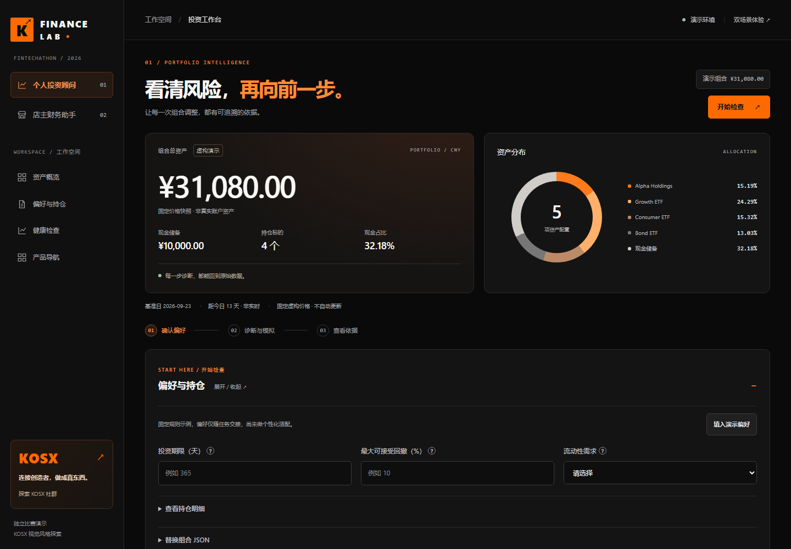

# Finance Lab · 金融比赛双工作台

v0.11.0 / 2026-10-06。基于团队原有业务，统一为 KOSX 风格黑橙界面。**独立比赛演示，非 KOSX 官方金融产品。** 配色参考 [KOSX 官网](https://kosx.ai/)，不复制社群数据、成员信息或商业承诺。



| 入口 | 任务 |
|---|---|
| `/`、`/investment` | 组合概览 → 偏好与持仓 → 风险诊断 → A/B/C 比较 → 证据与导出 |
| `/merchant` | 余额与缺口 → 账单来源 → 明确核对 → 现金情景、提醒、处理备注与导出 |
| `/catalog` | 选择两个独立工作台 |

## 直接运行

需要 Node.js 22 或更新版本。**网页运行没有第三方依赖、无需 API Key，也不用安装测试依赖。**

从仓库根目录启动服务：

```powershell
cd chenchen
node server.js
```

打开 [投资工作台](http://127.0.0.1:4175/)、[店主工作台](http://127.0.0.1:4175/merchant)。Windows 也可双击 `启动两版.cmd`。关闭服务后页面停止运行；直接双击 HTML 不能访问后端。

如端口被占用，先确认是否已有服务。需要另开实例时指定新端口，不要停止来源不明的进程：

```powershell
$env:PORT = '4180'
node server.js
```

然后打开 `http://127.0.0.1:4180/`。代码更新后应重启后端，再执行运行实例检查。

## 三分钟演示

**投资端：**首屏看组合总额与配置环图 → 点击「开始检查」→「填入演示偏好」→「开始健康检查」→ 比较三条路径 → 展开方案、收益曲线、运行记录 → 下载分析 JSON。修改偏好后旧结论隐藏，必须重新检查。

**店主端：**点「去核对账单」→ 打开一笔账单核对来源与净额 → 关闭弹窗并勾选确认 → 生成提醒 → 在现金日历将到账假设改为延迟 3 天 → 查看缺口前移 → 给提醒保存处理备注 → 下载核对摘要。

详见 [交付与验收说明](docs/ui-redesign/02-delivery-and-acceptance.md) 和 [页面地图](docs/ui-redesign/01-design-and-page-map.md)。

## 检查与测试

语法与核心测试不需要安装依赖：

```powershell
node scripts/check.js
node --test
```

本轮 46 项单元 / HTTP 测试，包括账单、金融计算、同源保护、页面资源、分配图数据及错误说明。使用开发依赖运行浏览器交互、五档屏宽及 axe 可访问性测试：

```powershell
npm ci
npx playwright install chromium
npm run test:ui
```

如电脑已经安装 Chrome，可省略下载 Chromium，并选择该浏览器：

```powershell
$env:PLAYWRIGHT_CHANNEL = 'chrome'
npm run test:ui
```

浏览器测试自行启动独立临时端口，只使用合成数据，完成后关闭测试服务，不改正在运行的演示会话。报告、截图、下载验证文件保存在 `artifacts/ui/`，默认不提交；`UI_REPORT_DIR` 可指定目录。29 组检查全部通过。自动可访问性检查不等于完整 WCAG 认证。

检查**实际运行中的服务**与本地源码是否一致（先启动服务）：

```powershell
node scripts/smoke.js
```

使用自定义端口时，检查终端也要设置同一个 `PORT`。

## 公开演示与长期部署

当前验收记录中的 Cloudflare Quick Tunnel 为临时地址；本机服务和隧道持续运行时可访问，无永久可用保证。示例只有虚构数据。**不要导入真实账单或账户信息。** 未建立成员登录，不适合正式金融服务。

公开演示使用独立端口，仍只监听回环地址，由隧道代理：

```powershell
$env:PORT = '4176'
$env:HOST = '127.0.0.1'
node scripts/start-public.js
```

在另一个终端使用官方 Cloudflare 工具创建临时 HTTPS 地址：

```powershell
cloudflared tunnel --url http://127.0.0.1:4176
```

长期托管可沿用 Node Web Service。仓库为 **`Fintechathon-agent/Fintechathon-agent`**，根目录 `chenchen`，构建 `npm ci --omit=dev`，启动 `npm run start:public`，健康检查 `/api/demo/portfolio`。`HOST=0.0.0.0`，端口使用平台 `PORT`。团队审核后再指定对应部署分支。

当前**未完成固定域名、Render 账户连接或自动部署**。历史文档里的个人仓库不是本轮同步目标，不会自动双仓推送。

## 设计与工程改动

- 黑色工作台、橙色主操作、侧栏 / 手机双产品导航、首屏任务捷径、社群官网入口。
- 配置环图、资产总额与现金占比读取演示快照，不用硬编码装饰数据。
- 保留 A/B/C、工具证据、持仓替换、核对、情景、关注、状态、备注和下载功能。
- 增加持久错误、重试、防重复提交、空态清筛选、单笔试算过期结果清理、导入后读取失败恢复。
- 增加跳过导航、可见焦点、Esc 关闭及弹窗焦点恢复、减少动态效果支持和 404 导航。
- CSS 与图标本地提供，无第三方字体、追踪、外部脚本或图片依赖。
- 保留静态白名单；公开模式也校验 Origin；增加 CSP、禁止嵌入与 MIME 嗅探保护。
- 修复原 smoke 仍把 `/` 当产品目录检查的问题。

## 计算口径与功能边界

- 投资价格固定截至 2026-09-23，仅 7 个虚构价格观测。不是实时行情、真实账户盈亏、个性化投资建议或样本外回测。
- 偏好仅进入任务交接，候选仍为固定规则示例。A/B/C 与当前配置同起点、同日期、同成本。单向换手乘 0.1% 扣费；联合收益区块重采样使用 2,000 条路径、固定种子、20 个交易日；短样本分位数只展示机制。
- 约束不能满足时中止，不自动放宽。`/api/paper-trade/execute` 仍固定返回 503，未接真实交易或团队 Safety Action Gateway。
- 店主示例为虚构的巷口咖啡，基准日 2026-10-04，金额按整数分计算。已结算款不重复加入余额，逾期待收不假设到账，逾期应付款预留在次日。
- 14 天现金只含已知账单，不含未来销售、未知支出、税务、真实平台结算日历。采购支出不是利润；只有同品同单位才拆分数量 / 单价影响。退款仅支持附着原收入，不支持跨期独立退款、多币种或转账。
- 核对门槛为“至少查看一笔来源并明确确认”，不等于审计全部凭证。提醒不会自动发送，也不自动付款。
- 账单、核对、备注、任务、审计和记忆均在服务进程内，**重启清空**；可手动下载备份。店主按浏览器会话隔离，投资仍为单用户演示，无多租户身份认证。记忆仍需显式 consent。
- 未新增登录、大模型、OCR、银行 / 平台连接、持久化数据库或交易审批功能。内部纸面交易 mock 仅用于单元测试。

## 主要接口

| API | 用途 |
|---|---|
| `GET /api/demo/portfolio` | 投资快照 |
| `POST /api/health-check/run` | 投资诊断与模拟 |
| `GET /api/task/{id}`、`/api/audit/{id}` | 状态 / 工具证据 |
| `GET /api/task/{id}/export` | 下载分析 |
| `GET /api/merchant/ledger?delay=0` | 账本与现金情景，delay 支持 0/3/7 |
| `GET /api/merchant/bill?id=...` | 来源与已查看状态 |
| `POST /api/merchant/review` | 确认当前 revision |
| `GET /api/merchant/insights?delay=3` | 确认后的提醒 |
| `POST /api/merchant/follow`、`/api/merchant/notice` | 关注 / 处理状态与备注 |
| `GET /api/merchant/scenario?bill=...&delay=3` | 单笔到账延迟试算 |
| `POST /api/merchant/import`、`/api/merchant/reset` | 替换账本 / 恢复演示 |
| `GET /api/merchant/export?type=ledger` | 导出，type 可为 ledger/review/demo |

## 协作与回滚

只向指定团队仓库推送。当前功能分支 `codex/kosx-finance-ui`，通过拉取请求交付，不擅自合并主分支。每轮检查、提交、推送并核对 SHA；保留原有未提交学习资料与输出文件。

回滚前导出需要保留的会话数据。可从基线 `05cfc55` 建立独立工作树和端口作对照；团队已合并后的回滚使用 `git revert`，检查后推送，不强推或覆盖协作者历史。
