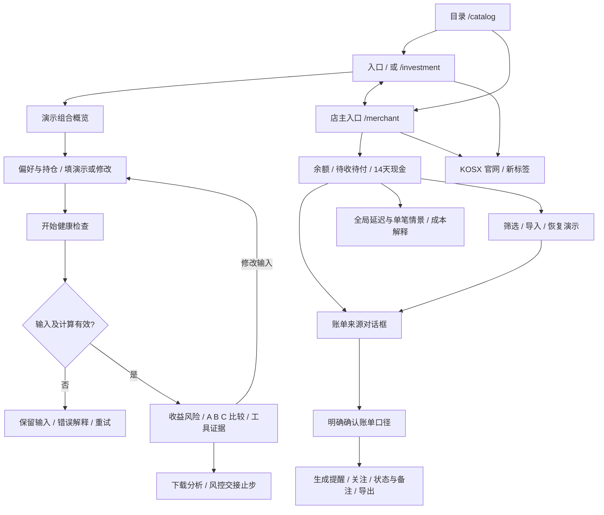

# KOSX 风格金融比赛界面：设计依据与页面地图

日期：2026-10-06。基线：团队仓库 `05cfc55`。本轮仅向用户指定的团队仓库同步，不向历史文档中的个人仓库推送。

## 已核实的输入

- 用户需要在现有投资理财、店主财务助手两套界面上做设计；保留业务与架构，借鉴 KOSX 配色和设计气质。
- 附件中的群聊是需求背景；视频号截图的工作步骤由用户明确采用：读项目、页面地图、结构、视觉、状态、移动端验收、发布与回滚。
- 截图实际展示的是两条 Cloudflare 临时页面链接，不是 GitHub 链接。同步目标以用户的 AGENTS.md 为准：`Fintechathon-agent/Fintechathon-agent`。
- 两条临时地址在本轮查询中未能读取，不能宣称已逐项检查旧线上页。从团队最新源码恢复相同 `/` 与 `/merchant` 入口。
- 初始 42 项测试全部通过。原有蓝色理财、绿色店主界面共用原生 HTML/CSS/JS + Node 后端，无运行依赖。
- KOSX 官网 https://kosx.ai/ 与 https://github.com/KOSXAI 互相对应。官网样式存在 `#0a0a0a`、`#ff6a00`、`#f7f7f5`、`#9a9a9f`、`#2a2a2e`。仅借鉴视觉，不采用其社群指标、人员或项目文案。

## 设计决策

黑色工作台、橙色主动作、暖白数据、细灰分隔；大数字与紧凑信息行形成层级。独立比赛演示身份保持可见。KOSX 社群入口指向已核实官网，不声称官方出品或金融资质。

桌面使用固定侧栏、轻量顶栏、双产品切换；手机侧栏收为产品导航，主要动作保持可触达。统一视觉标记、图表、表单、账单对话框、反馈组件。保留投资优先入口及 `/catalog`。

## 页面地图

## 核心任务与状态

| 场景 | 主动作 | 加载 | 失败 | 成功 / 空状态 |
|---|---|---|---|---|
| 投资初始化 | 查看演示组合 | 首屏读取占位 | 常驻错误与重试入口 | 实际快照总额、仓位与日期 |
| 投资检查 | 开始健康检查 | 防重复提交，状态文案 | 保留偏好、隐藏旧结论、可重试 | 三条路径、依据、导出 |
| 投资输入变更 | 重新检查 | 旧请求结果丢弃 | 非法 JSON 有中文解释 | 旧结果不会误当新结果 |
| 店主初始化 | 查看账单 | 读取占位 | 常驻错误与重试入口 | 正确余额及待核对数量 |
| 来源核对 | 看账单 | 请求期间反馈 | 可重试 | 对话框、已查看标记 |
| 核对确认 | 生成提醒 | 按钮忙碌且防重复 | 保留核对状态，错误可见 | 提醒、摘要可下载 |
| 账单筛选 | 输入 / 清空 | 本地即刻 | 无 | 无匹配时提供清空入口 |
| 导入 | 校验并导入 | 忙碌、防重复 | 原账本不损坏 | 新 revision，重新确认 |
| 现金情景 | 切换 0/3/7 天 | 隐藏过时解释 | 恢复可用状态 | 图表与说明使用同一情景 |
| 单笔情景 | 开始试算 | 防重复 | 常驻错误 | 输入变化后清除过期结果 |
| 未知页面 | 返回产品 | 不适用 | 404 指引 | 可返回投资或店主 |

## 风险与优先级

P0：不覆盖协作者未提交文件；不改变金融计算口径；交易接口继续关闭；演示数据不冒充真实账户或实时行情；所有修改经测试与远程同步。

P1：核心两条路径能完成；手机无整页横向溢出；键盘焦点可见；弹窗可关闭；错误、空态、重试与异步过期结果处理。

P2：字体、间距、动效、社群入口、目录和交付演示文档。尊重 reduced-motion 设置。

不添加登录、真实支付、LLM 接入、持久化财务数据库或未经验证的社群统计。保留服务进程内会话限制，明确展示。

## 分轮交付

1. 设计依据、页面地图与验收基线。
2. 双端导航、黑橙视觉、组合概览、统一状态组件，实际运行验收。
3. 异常路径、移动端与可访问性回归，补齐演示与发布回滚文档。

每轮只提交相关文件，测试与差异检查后推送；结束核对远程 SHA。协作使用 `codex/kosx-finance-ui` 工作分支和拉取请求，不擅自合并主分支。
