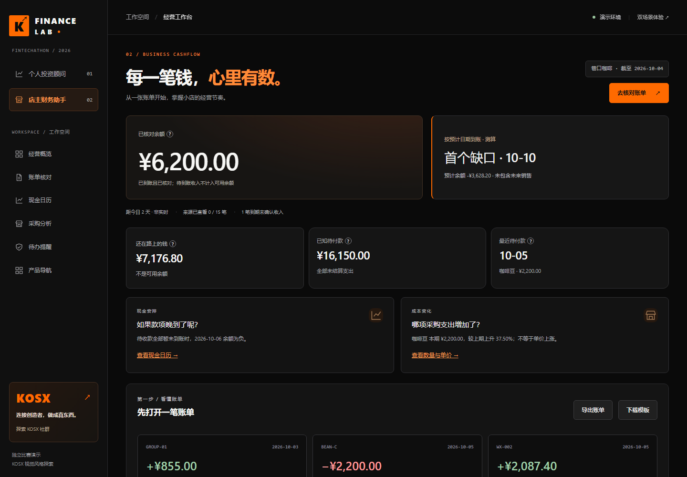

# 交付与验收记录

验收日期：2026-10-06（北京时间）。版本：v0.11.0。

## 打开成品

| 场景 | 本机运行入口 | 临时在线演示 |
|---|---|---|
| 投资 | http://127.0.0.1:4176/ | https://paint-commit-cinema-else.trycloudflare.com/ |
| 店主 | http://127.0.0.1:4176/merchant | https://paint-commit-cinema-else.trycloudflare.com/merchant |
| 产品导航 | http://127.0.0.1:4176/catalog | https://paint-commit-cinema-else.trycloudflare.com/catalog |

本机 `4176` 为本次独立演示进程；普通启动默认 `4175`。临时链接依赖这台电脑、服务和 Cloudflare 隧道持续运行，关机或停止隧道后失效，不等于固定域名或长期部署。网页查询工具无法读取该临时域名，本轮通过 HTTPS 实际请求与浏览器流程验证成功。

## 设计成果

两个页面共用黑橙系统，保留独立产品与原来的计算。KOSX 以视觉参考、社群官网入口出现，不虚构官方合作。配色依据与需求区分见 [设计记录](01-design-and-page-map.md)。

手机全页截图：[投资](investment-mobile.png)、[店主](merchant-mobile.png)。

## 验收路径

1. 投资页面点击「开始检查」，填入演示偏好并运行。预期组合总额 ¥31,080.00，现金 ¥10,000.00，现金占比 32.18%；总资产和环图由快照计算。
2. 检查当前配置及 A/B/C 三种方案，展开路径细节、收益曲线和工具证据。C 仅标为本段样本内回撤较小，不做个性化推荐；下载 JSON 包含交接状态。
3. 修改期限，旧结论立即隐藏；故意填错 JSON，输入保留并显示可操作的中文错误。可重新输入或刷新载入演示。
4. 店主页面当前余额 ¥6,200.00；按预计日期首个已知缺口 10-10。打开一笔账单，核对原始来源、扣费、退款与净额后关闭。
5. 勾选确认并生成提醒；到账假设改为延迟 3 天，缺口前移到 10-06。单笔情景修改参数后旧试算消失，避免误读。
6. 给提醒保存备注、切换处理状态、刷新，当前会话保留；下载摘要后核查账本与提醒字段。
7. 空筛选可清除；非法导入不会因校验失败覆盖账本；导入已成功而读取失败时明确提示重读，不假称原账本仍保留。
8. 手机首屏提供操作捷径，两产品可切换；按 Tab 可跳过导航；账单弹窗按 Esc 关闭并把焦点还给来源按钮。

## 已执行检查

| 检查 | 结果与边界 |
|---|---|
| 原始基线 | 42 项全部通过，作为回归基线 |
| 最终单元 / HTTP | 46 项全部通过，含金额口径、风险逻辑、页面资源、环图数据、Origin、404 |
| 浏览器 | 29 组全部通过，包含两个完整流程、错误与异步输入、导入 / 导出及恢复 |
| 屏宽 | 320、390、768、1024、1440 px，三页面无整页横向溢出；宽表格在容器内滚动 |
| 可访问性 | axe WCAG 2 A/AA 与 2.1 AA 自动规则检查：首页、商家、目录、投资结果及账单弹窗未检出违规；非完整认证 |
| 运行实例 | smoke 核对 HTML、CSS、JS、图标的响应与本地文件一致 |
| 临时线上 | 理财首页、店主页、样式、快照请求返回 200；实际浏览器完成投资诊断、账单核对与提醒 |
| 人工视觉复核 | 查看真实浏览器截图，检查黑橙层级、图表、首屏、长页面、手机与结果状态 |

自动报告：[browser-test-report.json](browser-test-report.json)。使用 Playwright 1.63.0，Chrome 154.0.8037.95；不是物理手机测试，未声称已测 Safari 或所有浏览器。

## 分轮提交与同步

- `8951e72`：读取最新项目、设计依据、页面地图与风险分级；已推送。
- `775d900`：黑橙双工作台、环图、错误恢复、响应式与首轮浏览器检查；已推送。
- 最后一轮：公开模式同源保护、404、键盘焦点、扩展验收和本文；确切提交编号以拉取请求最新 head 和最终交付消息为准，避免文档自引用产生循环提交。

工作分支 `codex/kosx-finance-ui`。远程目标 `https://github.com/Fintechathon-agent/Fintechathon-agent.git`。只提交本轮相关内容，不提交原本未跟踪的学习材料、临时下载、进程日志、依赖目录或密钥。主分支保持团队版本，使用拉取请求交付。

## 可回滚与未扩展范围

基线 `05cfc55` 保留不动，可用独立检出和不同端口运行对照。工作分支各轮提交可逐一审阅；团队合并后若需撤回，应创建 revert 提交并测试，不强推。

账户、交易、金融计算边界与原系统一致：虚构固定价格、短样本、规则候选、交易接口关闭、会话内存状态。重启会清空账本和备注，先导出保存。没有绑定固定域名、建立真实登录、支付、银行接口或持久化数据库。

KOSX 样式可在 `versions/kosx.css` 调整；业务脚本继续使用原页面元素和接口。`core/`、`tools/financial-tools.js`、`merchant/ledger.js` 均未修改。
