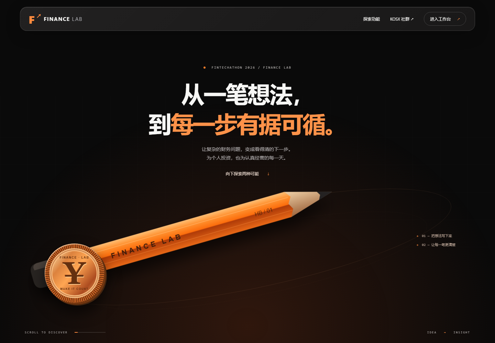
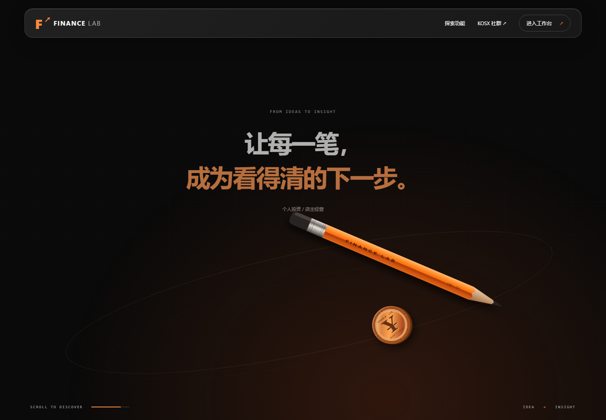
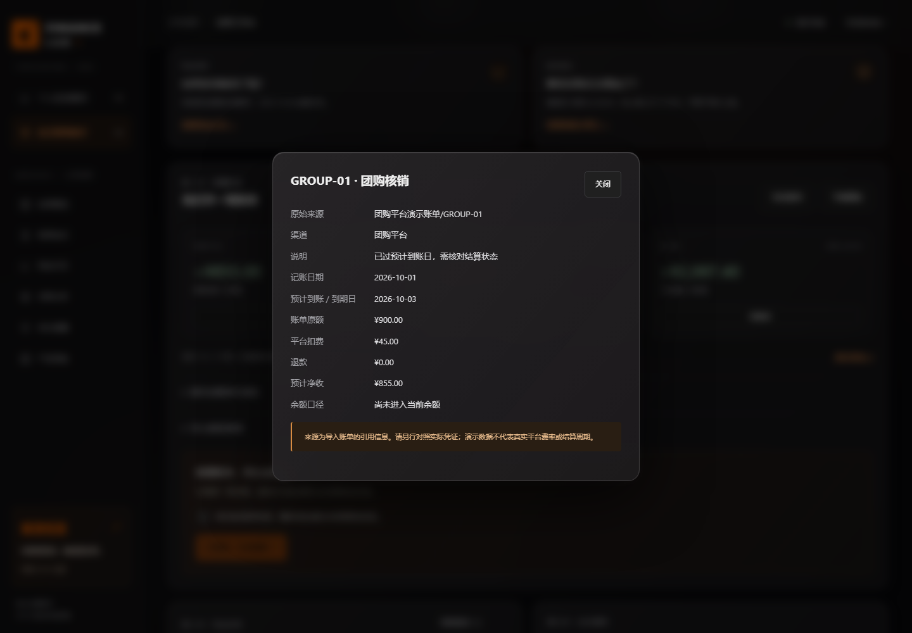

# 展示首页与磨砂玻璃验收

版本 v0.12.0 / 2026-10-06。先完成 v0.11.0 的测试、文档、独立预览与 PR #2，再在 `codex/kosx-landing-glass` 推进本轮。旧版预览由独立发布快照提供，不随新版本变化。

验收入口：[展示首页](https://toys-intro-viruses-starsmerchant.trycloudflare.com/)、[本机预览](http://127.0.0.1:4177/)。已通过真实 HTTPS 浏览器访问完成展示入口、投资诊断、店主账单核对及提醒生成，未发现浏览器未捕获异常。临时域名由服务随机分配。

## 页面地图与使用顺序

```text
展示首页 / 或 /index.html
  ├─ 原生向下滚动：铅笔与硬币向右滚动、缩小
  │   └─ 展示场景向上退出 → 两个核心功能卡片
  ├─ 个人投资 /investment → 持仓 → 健康检查 → 方案 → 证据导出
  ├─ 店主经营 /merchant → 账单来源 → 确认核对 → 情景 → 记录导出
  └─ 社群入口 → https://kosx.ai/
工作台左上品牌 → 展示首页；/catalog 保留产品目录
```

## 设计与交互

- 默认进入完整展示首页，不自动进入工作台；导航提供直接进入，熟悉产品的人无需看完动画。
- 铅笔为原创 SVG，硬币为 CSS 金属质感图形。左侧大物件随滚动向右移动、缩小并旋转；反向滚动可复位，不拦截鼠标滚轮，也不锁住触摸或键盘滚动。
- 展示段高度 225svh，场景原生 sticky；下方功能自然随页面上移进入。只在滚动或尺寸改变时安排一次动画帧，更新 transform 与展示进度。
- 半透明面板、柔化光边、背景模糊应用于两端工作台、目录、侧栏、导航与账单弹窗。文字和图表保留稳定深色底，避免透明度影响读取。
- 开启“减少动态效果”时为静态首屏，无额外长滚动段；禁用 JavaScript 后仍能从功能链接进入产品。工作台业务操作本身依然需要 JavaScript。
- 支持“减少透明效果”偏好与不支持 backdrop-filter 时的深色底回退。
- 桌面、手机共用正常页面滚动；没有新图片服务、字体服务、第三方动画库或追踪。

## 设计依据

按用户要求，仅借鉴 [KOSX](https://kosx.ai/) 的黑橙、简洁科技视觉。材料参考 [Apple Materials](https://developer.apple.com/design/human-interface-guidelines/materials) 与 [Liquid Glass 概览](https://developer.apple.com/documentation/TechnologyOverviews/liquid-glass) 中的层次、透明度与可读性原则。本实现为网页磨砂玻璃，不宣称复制系统原生渲染，也不宣称 KOSX 官方合作。

## 已执行检查

| 项目 | 结果 |
|---|---|
| 单元与 HTTP | 46 项通过，业务计算、同源校验与资源白名单保留 |
| 浏览器 | 34 组通过，含原有完整流程与新展示入口、位移 / 缩小 / 复位、低动态偏好、无 JavaScript 入口、玻璃弹窗 |
| 屏幕宽度 | 320 / 390 / 768 / 1024 / 1440 px，四页面无整页横向溢出 |
| 自动可访问性 | axe WCAG A/AA 对展示页、投资、店主、目录、结果、弹窗未检出违规；非完整认证 |
| 实例一致性 | 本机 4177 的页面和所有资源与当前源码相符 |
| 视觉复核 | 桌面首屏、滚动中段、功能入口、手机首屏、完整手机页和玻璃弹窗截图已查看 |

测试环境：Windows 上 Chrome，Playwright。没有声称真机 Safari 或所有浏览器已测。报告见 [本轮自动报告](landing/browser-test-report.json)。







手机：[首屏](landing/landing-mobile-start.png)、[功能全页](landing/landing-mobile.png)。

## 部署与回退

本轮为独立工作分支，PR 基于已交付的 `codex/kosx-finance-ui`，团队应先审核 PR #2，再合入本轮；没有自动合并主分支。v0.11.0 基线提交 `20da8d4` 保留，页面、业务接口和导出格式保持兼容。

运行仍为 Node.js 22+，无运行依赖。启动方法、计算口径及演示限制见 [README](../../README.md)。公开预览依赖本机服务与临时隧道持续运行；未建立永久域名或长期托管。所有业务数据仍为合成示例、内存保存，不接入真实交易。
