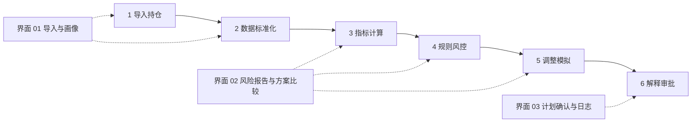
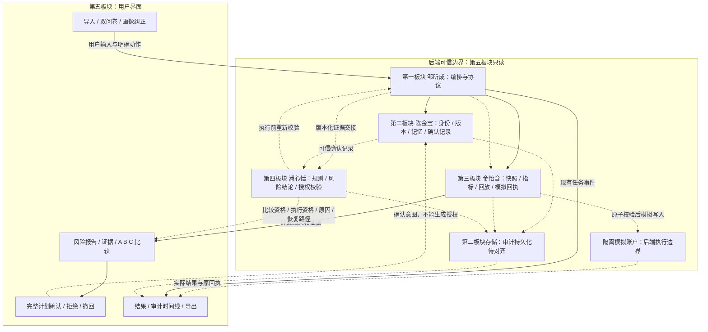

# 产品交互与演示：界面架构

日期：2026-10-08。负责模块：第五板块（李想）。状态：UI 设计文档，待跨模块评审；不是公共 Contract，也不表示已联调。

## 1. 范围和证据

本轮基线为 `codex/kosx-landing-glass` 的 `b6090b4`。仓库清单为 v4；用户下载附件为 v3，以用户指定的仓库 v4 为准。第 6 节第 2 步已经完成，不重复入库。

只改界面、UI 检查、独立原型和文档。后端、风险规则、金融计算和核心数据只读。首页正式版在用户选定 A / B / C 之前保持原状，店主入口下线安排在选定之后。

### 远程只读核查

| 分支与核查 SHA | 发现 | 可以得出的结论 |
| --- | --- | --- |
| `codex/fixed-risk-demo-v0.1` / `8cd0a8a104edcf59655d344e78532c18cd09f505` | Vesper 提交固定风险规则 v0.1、风控逻辑架构、`risk-rules-demo/` | 有 R01–R10 固定规则及案例原型；不是正式 Risk Engine，跨模块仍待确认 |
| `codex/risk-policy-v0.2-only` / `51a8763c425eb5de30ce0e1d1d1def83197f7463` | Vesper 提交权限风控规划表 v0.2 | 有 35 条规划规则；没有上述 10 条固定规则文档或交互原型 |

可复查的固定版本来源：[固定规则](https://github.com/Fintechathon-agent/Fintechathon-agent/blob/8cd0a8a104edcf59655d344e78532c18cd09f505/docs/safety-risk-eval/固定风险规则-v0.1.md)、[案例模型](https://github.com/Fintechathon-agent/Fintechathon-agent/blob/8cd0a8a104edcf59655d344e78532c18cd09f505/docs/safety-risk-eval/risk-rules-demo/model.js)、[旧规划](https://github.com/Fintechathon-agent/Fintechathon-agent/blob/51a8763c425eb5de30ce0e1d1d1def83197f7463/docs/safety-risk-eval/权限风控规划表-v0.2.md)。本轮只读，没有切换、合并、复制执行其他 Owner 的代码，也未复跑其原型测试。

固定规则涵盖权限、数据、资金与硬约束、集中度、行业、回撤、相关性、确认、去重、审计。双口径演示上限为单只 35% / 50%、前三 75% / 90%、行业 40% / 60%（总资产 / 投资部分）；超过才触发。相关性须同时满足系数 ≥0.8、两项占总资产 >40%。这些仅记录 Vesper 提案，不是行业统一阈值，不在第五板块重新计算或启用。

### 两项需要确认的版本差异

1. v0.2 规划不设指标硬阈值、无自动减险豁免；固定规则 v0.1 引入演示阈值及满足严格条件的逐步改善例外。不得自行择一实现，交第一、四板块确认生效政策与版本。
2. 远程固定规则分支含 `chenchen/contracts/investment-agent.v1.schema.json` 和严格健康检查信封；当前 UI 分支仍使用旧裸字段请求。远程文档称健康检查 Contract 已冻结，但不等于已集成本分支，且 RiskDecision / Approval 仍待统一。集成前由架构 Owner 明确目标版本；不把新字段塞进旧请求。

## 2. Golden Path 与三类界面

保留组长的六步业务顺序；现有演示在生成候选、模拟后交接 `RISK_CHECK`，两者的编排差异由第一板块处理。UI 不擅自调整后端阶段。

| 界面 | 核心问题 | 当前可读内容 | 需要补齐与未就绪表现 |
| --- | --- | --- | --- |
| 01 导入与画像 | 用了谁的哪些资料？ | 演示持仓、风险偏好、导入接口 | CSV / 手动 UI、基础 / 详细问卷、原始回答与模型归纳分栏、逐项确认约束；缺项显示未知，不能当零 |
| 02 报告与比较 | 为什么提出这个方案？ | 指标、集中度、相关性、候选方案、历史模拟、工具证据 | Health Score 缺失时显示未提供；RiskDecision 未接时显示待风控检查；注意点不升级成风控结论 |
| 03 计划确认与日志 | 用户确认了什么，实际发生了什么？ | 当前任务与进程内事件、导出 | 独立原型先展示完整计划、逐项接受、拒绝 / 撤回、版本失效、执行及审计缺口；没有可信回执只显示模拟 / 待确认 |

所有入口落在同一投资主链路。股票和基金 / ETF 按工具返回的 `type` 分组：当前 `A_SHARE`、`ETF`；现金独立呈现。首版模拟执行范围以 Owner 确认的普通 A 股、候选池场内 ETF 和现金为限；场外基金不能因界面写了“基金”就被赋予执行资格。

## 3. 数据流与隔离边界

实线表示职责数据流，虚线表示待确认接线；图不表示接口已经实现。

## 4. 字段所有权与真实接入状态

| 字段或信息 | 生产 / 定义 Owner | 当前 UI 分支证据 | UI 的使用方式 |
| --- | --- | --- | --- |
| `task_id`、`session_id`、`task_state`、checkpoint | 第二板块；第一板块统一协议 | `core/harness.js`、`server.js` | 显示阶段、恢复进度；不把任务状态当 Risk State |
| `portfolio_snapshot`、资产 type / 金额 / 数据日 | 第三板块 | `tools/financial-tools.js`、演示数据 | 当前示例总资产 ¥31,080.00；展示固定历史日期，不称实时 |
| `health_report.metrics`、`concentration`、`correlation_matrix`、`hidden_clusters`、`attention_points` | 第三板块 | `diagnosePortfolio()` | 数值与证据原样解释；其中旧注意点阈值不是 Vesper R01–R10 |
| Health Score / 风险标签及算法版本 | 第三板块；第一、四板块确认语义 | 无 Health Score；已有 attention_points | 不自算评分；标签需区分工具观察和正式规则原因 |
| 候选、proposal、simulation、ToolResult | 第三板块；第一板块编排 | 现有健康检查结果 | 同口径比较；LLM 解释不能改数值 |
| `risk_handoff` / `contract_version` / `request_id` | 第一板块 | 仅所查远程分支有版本化 Contract | 等集成确认；`execution_allowed: false` 不是待前端解锁的按钮 |
| RiskDecision、全部原因、双用途资格、恢复动作 | 第四板块；第一板块统一字段 | 固定案例原型存在；当前工作台无正式返回 | 待接 Contract；不拷贝原型金融规则到正式 UI |
| Approval、逐项接受、计划与版本绑定 | 第二、四板块；第一板块统一接口 | 当前 `approval_id` 尚无有效网关流程 | UI 只发用户动作；不能自造 token 或有效授权 |
| 执行状态、幂等标识、模拟回执 | 第三板块；第二板块关联恢复 | `/api/paper-trade/execute` 固定 503 | 明确网关未接入；未知先核查，不能盲目重试 |
| `event_id/task_id/actor/event_type/payload/timestamp` | 第二板块；第四定义完整性、第一统一协议 | `addEvent()` 与 `/api/audit/:task_id` | 仅现有进程内日志；不宣称持久化、用户隔离或完整执行审计 |

## 5. 风险、确认、执行分开显示

- 风险：ALLOW / REVIEW / BLOCK 来自第四板块。ERROR 作为检查异常单独显示，暂停受影响功能；如何与三档决策映射待 Owner 确认，不能默认 ALLOW。
- 比较与执行分别显示；执行被阻止不必整页置灰，只有服务证明可读的证据和比较仍可用。
- REVIEW 的可接受原因逐项收集；数据 / 检查故障、执行未知、审计失败必须修复或核查，没有“勾选放行”。BLOCK 不得被确认覆盖。
- 确认的是当前完整计划：动作、金额或确定性方法、费用、时间安排、模式、停止条件、全部风险与未知项。普通 ALLOW 方案同样需要确认。
- 相关版本变化后，旧确认显示失效并停止未提交步骤；历史结果绑定旧版本，不覆盖已完成事实。
- 五种恢复路径：补充资料、更新数据、修正方案、重新确认、核查执行状态。每项指出责任方、缺什么、下一步；首版没有人工审核后台。

## 6. 五项安全机制怎样看得见

| 机制 | 第五板块呈现和验收 | 实际机制 Owner |
| --- | --- | --- |
| 幻觉防护 | 标注“工具计算 / 风险规则 / 模型解释 / 用户确认”；数字能追到来源和版本；无回执不显示成功 | 第二、三板块；第四约束 |
| 注入防御 | 外部文字以文本渲染；注入字符串不能变成按钮或改状态；保留服务端拦截原因 | 第二、四板块 |
| 操作审计 | 关联输入→工具结果→风险→确认→执行→时间；失败和缺口不能伪装已留痕 | 第二持久化；第四完整性；第一协议 |
| 异常熔断 | 在受影响动作旁显示检查失败 / 暂停 / 恢复入口；不重复堆全站状态栏 | 第四判定，第一编排 |
| 沙箱 | 显示模拟模式和数据时点，架构图画隔离边界；页面装饰不声称提供隔离能力 | 第一、二、三板块 |

## 7. 本周交付边界

周四只交本文、[需求提案](../contract-proposals/2026-10-08-ui-needs.md)、[首页方向原型](../../review/home-directions/index.html)。首页 A / B / C 是布局方向，不是投资候选 A / B / C；原型清楚区分两者。原型仅演示导航与装饰交互，不生成风险结论、模拟收益或授权。

周五做计划确认 / 日志和资产比较原型；周六按用户选择下线正式店主入口。Owner 未确认就保持独立原型，不接新 Contract；周日补录屏、Demo Story、集成 PR 和经授权的公网同步。本轮没有进入集成或发布公网原型。
