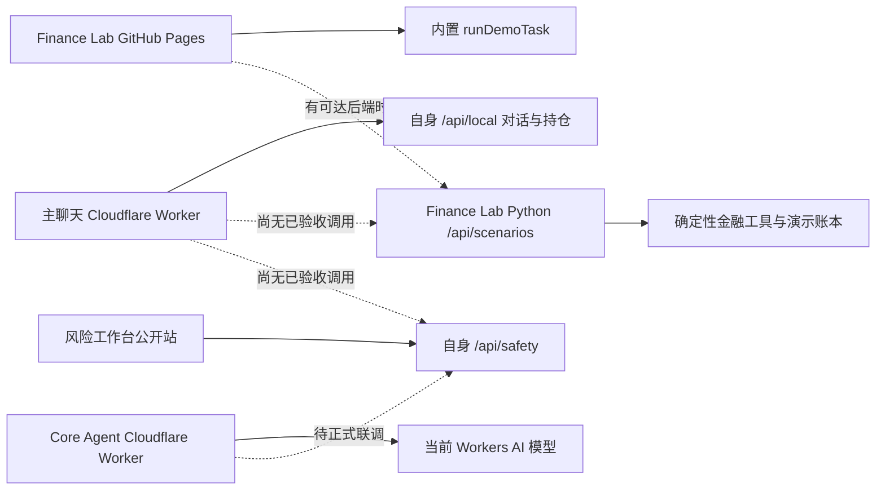

# 参赛集成审计与 P0 顺序（2026-10-25）

基线：团队仓库 `origin/main` 为 `60d67e68b99e829a3c64cd91746757f98875b6db`；本轮独立分支 `codex/competition-integration-20261025`。原有 `codex/long-text-workbench-integration-20261018` 工作区有未提交 Risk 文件，未移动或覆盖。要求先读的 `README.txt`、`TEAM_API_HANDOFF_20261024.md`、`0001-team-api-handoff.patch` 在已检查的团队仓库和工作区中均未找到，故未应用补丁。Owner 来自本轮任务分工，源码维护权仍须团队确认。

## 当前架构

公开主聊天页面及脚本当前只调用自身 `/api/local`；未找到它调用 Finance Lab、Risk 或 Core 的证据。Finance Lab 公开页可访问，但同域 `/api/scenarios/boot` 返回 404；离线时转入固定演示引擎。Risk 公开页与 `/api/safety/session` 可访问，但 10 月 18 日长文本分支的交付记录明确原站未更新。Core 公网 `/health` 当前报告 `cloudflare_workers_ai`，不能称为百炼已接通。这些只读 HTTP 结果不是全链路验收。

| 模块 | 本轮指定 Owner | 源码与接口 | 当前验证状态 | 阻塞项 |
| --- | --- | --- | --- | --- |
| 主聊天 | 理想、林粹 | 公开 Worker `/api/local`；本仓未找到部署源码 | 线上页面可达；三场景调用尚未验证 | 需源仓与部署权限，冻结对话任务契约 |
| Finance Lab | 七七 | `qiqi/web/app.py`、`qiqi/web/banking_service.py`；`/api/scenarios/run/confirm/cancel` | 本轮 171/171 本地测试、部分 HTTP 路径通过 | 本地为共享 `demo_user`；公开静态站无 API |
| Finance Lab 公开 UI | 理想、七七 | 外部仓库 `jinyihan77-create/finance-lab-demo`，HEAD `6ed9ee5`；`versions/workspace.js` | 线上页面可达；源码可读，当前账户无推送权限 | 固定答案、演示账单合计差 5.50 元、上传仅预览 |
| Core Agent | 林粹 | `chenchen/deployment/worker.js`、`/api/review` 与任务审计 | 本轮 287/287 本地测试；公网健康接口可达 | 正式 Risk 回调、主聊天路由与百炼真实调用未验收 |
| Risk | Vesper | `codex/long-text-workbench-integration-20261018` 的 `modules/safety-risk-eval`，`/api/safety/*` | 分支交付记录有旧测试；本轮未复测/合并 | 原站最新长文本未发布；签名回调与联合验收待办 |
| 集成与冻结 | Sean | 团队仓库、本审计与交付版本 | 独立分支已建立 | 仓库合并、Owner 确认、演示/设备验收 |

## 三个冻结场景及 P0

冻结场景为理财操作、账单分析、智能转账。订阅保留为候补；静态按钮和固定文案不计入完成。

1. **P0-A，统一真实调用关系。** 取得主聊天源码/部署权限，确定 `task_id/session_id/trace_id` 与 Finance、Risk 接口映射；在同一任务中验证问答、工具、风控、确认、模拟回执和审计。现在尚未打通，不能给出“完成后的实际调用图”。
2. **P0-B，修复公开 UI 的真实/演示边界。** `runDemoTask` 对任意含“转账”的请求固定给王芳 500 元，含“基金”的知识问句固定给卖出建议；演示账单总额 17,559.70 元而分类合计 17,554.20 元；上传仅解析前 200 行并留在浏览器，后续任务仍请求演示账本。需由 UI 仓库 Owner 合入修复并发布；当前连接只有读取权限。
3. **P0-C，执行安全。** Finance Lab 的红色“强验证”仍以客户端提交六位数字和 `face_verified=true` 为 Mock，不能当作真实身份认证。保持沙箱状态变更与真实银行隔离；执行端必须复核计划版本、风控、审批和最新余额。
4. **P0-D，模型费用与接通。** 百炼 `qwen3.8-flash` 的适配与动态总额/每日预算守卫在本分支完成替身测试。旧 Key 已暴露；账户余额、新 Key、空间权限和预算授权未核实，真实调用继续为零。见 [百炼接入准备](../../chenchen/docs/bailian-upgrade-2026-10-25.md)。

## 验收口径

本轮 Core 287 项测试通过，其中百炼专项 16 项；Finance Lab 在隔离工作树的 Python 3.13 虚拟环境安装 PyYAML 6.0.3 与 NumPy 2.2.6 后，171/171 项通过。修正一处固定期待“2026-10-25”的测试：该日期到来后解析器会安排下一年的生日；现在断言月日正确且日期不早于今天。测试中的模拟审计故障日志为预期注入，不代表本轮线上故障。

本地 HTTP 探测：2026 年 10 月账单总额和分类和均为 17,559.70 元；“给张伟转账 700 元，备注房租”生成张伟/700 元黄色待确认，首次确认在熔断锁定状态下被拒且余额不变；人工恢复演示熔断后，确认使模拟余额从 25,680.50 元变为 24,980.50 元，再次确认未重复扣减。“基金是什么”由场景路由转交理财路径，尚未验证后续知识回答。这些结果只证明本地服务和虚构账本，不证明公开主聊天全链路。

Risk、主聊天的本轮统一端到端用例、真实百炼调用、大陆无代理网络及 iOS/Android/Windows/macOS 设备验收均未完成。官网公开页面为 JavaScript 应用，报名后台、正式附件和准确截止时刻尚未读取；11 月 2 日截止日期只按任务输入记录，须由 Sean 在报名后台复核。

只使用虚构资料和沙箱余额。公开演示的固定数据必须逐结果标注来源、模式和任务编号；模型输出不代替工具、风控、用户授权或执行日志。
