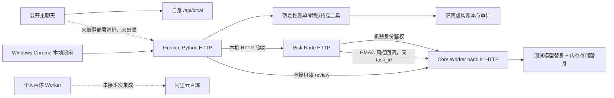

# 参赛集成审计（2026-10-25 更新）

当前交付物是可运行的本地沙箱与有真实 HTTP 连接的 Finance → Risk → Core 集成候选版。主聊天的三场景统一入口、真实模型和线上 staging 尚未完成验收。冻结场景：理财操作、账单分析、智能转账；所有资料虚构、资金模拟。

主仓库 Fintechathon-agent/Fintechathon-agent，分支 `codex/competition-integration-20261025`，Draft PR #31。最初 main 基线 `60d67e68b99e829a3c64cd91746757f98875b6db`。原工作区未提交改动保留。`README.txt`、`TEAM_API_HANDOFF_20261024.md`、`0001-team-api-handoff.patch` 在已检查工作区未找到，未应用。

## 源码与版本

扩大到全部远程分支核查后，找到并合入以下队友成果，纠正先前“签名回调/适配缺失”的过宽判断；主聊天部署源码仍未取得。

| 输入分支 | 输入 SHA | 集成 merge |
| --- | --- | --- |
| codex/core-risk-auth-readiness-v1 | 9e6bed133c36f7fa42fc15f4dc7a8791049b0841 | 1308d9d |
| codex/risk-joint-acceptance-v1 | f6dd8e38f053da736bbb7dca44a2e8b636b398c0 | 47a31ac |
| qiqi/core-agent-adapter-20261020 | 05fc4359c1fbe563993e5778d1bb45631fa922ce | 91411251fe538edd4bc47df0f2ad2aeb37ab4e9c |

报告的 core_commit 是取样时 HEAD；CURRENT_TRACKED_WORKTREE 表示实际运行当时已跟踪文件的当前内容，逐文件 SHA-256 随报告保存。它不是线上部署版本。历史 pinned 验收保留，本轮额外复跑当前源码。

## 模块、唯一 Owner 与状态

Owner 按用户指定职责分配，维护权限仍需团队确认。跨模块依赖不设并列负责人。

| 模块 | Owner | 源码与接口 | 验证状态 | 输入依赖/阻塞 |
| --- | --- | --- | --- | --- |
| 主聊天 | 理想 | 公网 /api/local；实际 Worker 源码未取得 | 线上页面可达；统一调用尚未验证或受阻 | 正确源仓、团队账户与部署权限、用户/任务契约 |
| Finance 业务 | 七七 | qiqi/web/app.py、banking_service.py；/api/scenarios/*、账单导入、持仓契约 | 本地已通过：251 项回归、10 项计算/导入专项、3 个浏览器流程 | 用户和模式隔离；银行与投资当前是两套演示账本 |
| Finance → Core/Risk 适配 | 七七 | core_agent.py、risk_conversation.py；/api/core-agent/review、/api/review | 本地已通过：三个服务 HTTP + HMAC 回调 | 真实模型、持久存储与主聊天未接入此验收 |
| Core/Memory | 林粹 | chenchen/deployment/worker.js；review/task/approval/simulate API | 本地已通过：317 项回归 | 实际身份认证、记忆边界、百炼账户/预算和线上配置 |
| Risk/审批约束 | Vesper | modules/safety-risk-eval、team-staging/risk/long-text；conversation bridge、签名 callback | 本地已通过：677 项回归、12 项 HTTP 验收及构建检查 | 原站发布、可信最终用户授权、生产持久化 |
| 公开 Finance UI | 理想 | jinyihan77-create/finance-lab-demo，检查时 6ed9ee5；versions/workspace.js | 源码可读、页面可达；修改未发布 | 当前只读权限，仍有固定答案/上传预览与实际任务分离 |
| 版本集成/最终验收 | Sean | 本分支、PR #31、证据目录 | 本地已通过；线上验收受阻 | 统筹依赖、报名正式材料、四平台和大陆网络 |

## 当前实际调用图

实线为本轮本地已运行的边；Core 模型与存储使用替身。普通账单/转账走 Finance 自身沙箱，并未自动接入 Core 执行账本。不存在已完成的三场景主聊天统一闭环。

## 本轮修复

- Core 支持 qwen3.8-flash，保留动态预算预留和失败保守结算。修复本地旧模型白名单后，不再以旧白名单拒绝该模型；不代表线上部署已升级或上游账户已授权。
- Finance capabilities 请求携带机器鉴权；拒绝外部明文 HTTP、含凭据/路径的 Base URL、重定向和超大响应，避免服务密钥转发。过长问题明确报错；保持请求幂等键。
- live 模式拒绝客户端验证码/人脸布尔值授权执行；传入 mode:demo 不能绕过。演示验证记录 DEMO_MOCK、identity_verified:false。
- 未知现金/非有限金额不能默认为 0；精确持仓 60,000/20,000/20,000 得到 100,000 和 60/20/20%。
- UTF-8 CSV/TXT 导入绑定账单任务；整数分计算；保留并标注重复，退款抵减、收入不计支出，超限和坏行明确失败。知识问题不生成交易任务。
- 合并队友机器鉴权、Risk 签名回调、Python 适配与幂等日志；当前源码 HTTP 验收不再只依赖旧快照。
- Ajv 升级 8.20.0，安装审计 0 漏洞；修正界面回执对象显示；增加无模型调用、独立数据目录的演示启动器。

## 线上只读核验（北京时间 2026-10-25 14:37 左右）

| 地址 | 本轮结果 | 能证明什么 |
| --- | --- | --- |
| personal-ai-fund-chat.ai-banking-agent.workers.dev/ | HTTP 200 | 页面可达，不能证明集成验收 |
| finance-lab-core-risk-validation.realchenchenluo.workers.dev/health | HTTP 200；Workers AI、configured:false | 此独立 Core 验证环境未配置可用模型 |
| finance-lab-risk-bridge.realchenchenluo.workers.dev/health | HTTP 200；model calls/execution/joint acceptance 均 false | 只读桥存在，未开通完整执行 |
| xinlan-qwen38-share.lixjanus526.workers.dev/health | HTTP 200；qwen3.8-flash、configured=true、paidEnabled=true、accessMode=PUBLIC | 个人 Worker 报告已配置；不证明当前推理成功、余额或本任务预算 |

个人 Worker 分支 codex/tinglan-secure-ai-20261018 的历史文档记录 10 月 20 日两次成功调用和一次失败保守占额；这是历史材料，不计本轮真实模型通过数。本任务本轮真实模型调用 **0**，收费测试批准额 **0 元**。不使用截图旧 Key、不充值、不根据线上 paidEnabled 自动获得费用授权。

用户所述 personal-ai-fund-chat-staging 和 LLM_A_API_KEY 未在已检查源码中定位；个人 Worker 的 DASHSCOPE_API_KEY 不能证明团队 staging 有同名或异名绑定。本机 Wrangler 未登录，Cloudflare 页面要求登录，无法核验团队实际配置或部署。

## P0 与剩余风险

1. 理想：提供主聊天源码及正确团队 staging 权限，冻结身份/任务契约并串联三场景。当前阻碍线上闭环。
2. 林粹：核实专属地址、新密钥、模型权限、余额；取得明确测试预算后跑非流式、流式、结构化输出与工具调用、故障和费用对账。本地 Core 适配目前只覆盖非流式 JSON。
3. 七七：统一或明确分隔银行/投资账本，消除共享 demo_user 被当作多用户账户的风险；与林粹协作验证 Memory 更新、纠正、删除及用户/模式隔离。
4. Vesper：真实可信审批身份和集成存储下重跑未批、改参、过期、并发、回调故障与规则缺失。当前签名测试服务不是最终用户登录。
5. Sean：核实报名后台/正式附件/精确截止时刻，安排大陆无代理与 iOS、Android、Windows、macOS 彩排。仅实测本机 Windows Chrome；不能代表其余平台或大陆直连。

11 月 2 日提交日期按用户提供信息记录，官方 JS 页面/后台及附件未完成独立核实。10 月 30 日内部冻结目标保留。完整验收矩阵、复测命令、回退与演示脚本见 [交接单](competition-handoff-2026-10-25.md)。
