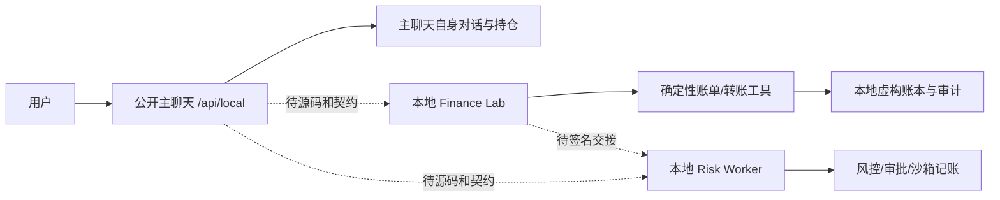

# Personal AI Fund Manager 参赛交接单（2026-10-25）

交付位置：团队仓库分支 `codex/competition-integration-20261025`。冻结候选场景为理财操作、账单分析、智能转账。所有数据和操作只用于虚构账户；本文件的“本地通过”不等于公开主聊天或线上 staging 通过。模块、Owner、仓库入口、当前实际架构及 P0 见 [现状审计](audit-2026-10-25.md)。

## 本轮可复现版本

| 模块 | 本轮变更 | 实测 |
| --- | --- | --- |
| Core Agent | 百炼模型 ID 改为 `qwen3.8-flash`，内部总额及北京时间每日预算串行预留、结算；旧账本保留 | 288/288 Node 测试，其中百炼 17/17 全是供应商替身；尚未收费调用 |
| Finance Lab 本地后端 | 上传 UTF-8 CSV/TXT 随账单任务发送，后端解析并返回 `batch_id`、`trace_id`、来源与金额；总额和分类用整数分汇总；精确基金定义问句按知识解释处理 | 177/177 Python 测试；独立 HTTP 请求得到 30.20 元且分类一致，错误金额 HTTP 400 |
| Risk | 合入已提交的长文本工作台到独立集成分支；修正“可能收入”先核对的测试；更新独立站打包导航 | 398/398 Node 测试；Worker 打包和 D1/沙箱检查通过；原站未发布 |

本轮 Risk 的验证只说明其自身 API、状态约束和沙箱工具可运行。主聊天源仓尚不可访问；没有主聊天 → Finance → Risk 的真实统一任务链路，也没有完成后的实际三方调用图。



公开 Finance Lab UI 是另一个只读仓库的静态部署，仍有固定答案、账单差额和上传只预览等缺口；本地修复不会自动改变该网站。公开 Core `/health` 仍显示 Cloudflare Workers AI。公开 Risk 原站仍需其 Owner 发布本分支构建。正式验收之前不得把这些页面合称为统一产品闭环。

## 15 项内部验收映射

状态只描述本轮证据。演示步骤均使用虚构数据。

| # | 要求与演示步骤 | 实现/证据 | 状态 |
| --- | --- | --- | --- |
| 1 | 三项资产 60,000/20,000/20,000，核对 100,000 与 60/20/20% | `chenchen/tools/financial-tools.js` 有确定性权重工具；本轮未用此精确夹具跑通 | 尚未验证精确夹具 |
| 2 | 上传含退款与重复的账单，核对明细、分类、总额 | `qiqi/tests/test_bill_import.py`：净额 45.30，分类相加相等；退款抵减、收入不计、重复保留并标记 | 本地已通过 |
| 3 | 输入“给张伟转账 700 元，备注房租”，查看待确认对象与金额 | Finance Lab 本地 HTTP 得到张伟/700 元；公网静态模式仍固定答案 | 本地已通过；线上受阻 |
| 4 | 问“基金是什么”，确认无买卖任务并回答知识问题 | 本地提供明确标注来源的基金定义，未生成审批或买卖计划；主聊天尚未验 | 本地已通过；线上受阻 |
| 5 | 上传两份不同文件，比较报告与批次 | `test_bill_import.py`：12.00/25.00 元、不同批次和 trace；HTTP 文件路径实测 | 本地已通过；公开 UI 受阻 |
| 6 | 12,000 元现金保护学费 6,000、房租 1,500、生活费 2,500，再申请投资 8,000 | `modules/safety-risk-eval/test/daily-gateway.test.cjs`：可用 2,000 元，8,000 元被 BLOCK | 本地已通过 |
| 7 | 直接执行未批任务；再改金额/对象/计划 | Risk gateway 与 Core 审批、版本测试覆盖前置拒绝；统一主聊天链路未验 | 模块本地通过 |
| 8 | 风控/审计故障、余额未知时执行 | Risk/Core 失败关闭测试覆盖，未见沙箱资金变更 | 模块本地通过 |
| 9 | 重发及并发同一已批动作 | Risk gateway、Finance Lab 沙箱测试验证一次效果与重放回执 | 模块本地通过 |
| 10 | 账单备注放入越权文本并检查账本 | `test_bill_import.py` 证明备注不改变余额或待办；Risk/Core 另有注入边界测试；主聊天全链未验 | 模块本地通过；联调未验 |
| 11 | 更新最低现金要求，再以另一用户读取 | Risk 会话隔离、Core 记忆测试覆盖部分条件；Finance Lab 共享 `demo_user` 不能宣称账户隔离 | 未达集成验收 |
| 12 | 鉴权、限流、超时、内部预算不足 | Core 百炼供应商替身和预算测试区分错误；真实供应商错误未验 | 本地替身通过 |
| 13 | 以分为夹具单位：已记 40.0203、占用 10、上限 50 | `chenchen/tests/bailian.test.mjs` 验证上游调用前拒绝且 attempts 不增加；并发预留另有测试 | 本地已通过 |
| 14 | 三场景由同一主聊天发起并查看同一任务编号 | 主聊天源码与 Finance/Risk 统一契约缺失 | 受阻 |
| 15 | 大陆无代理及 iOS/Android/Windows/macOS 代表浏览器 | 未掌握这些实际设备/网络的本轮记录 | 尚未验证 |

资金安全相关模块负例在本轮各自测试通过；统一入口的资金安全验收仍须完成 #7—#10 和 #14 的跨模块重跑。测试总量为 863 项模块测试（Core 288、Finance 177、Risk 398），不应把它们当作 863 项端到端用例。

## 运行、环境与回退

从团队仓库根目录运行。Node 24、Python 3.13 用于本轮验证；先在 `qiqi` 虚拟环境安装 `PyYAML==6.0.3`、`numpy==2.2.6`。本地服务：`cd qiqi; .\.venv\Scripts\python.exe web/app.py --port 8765`，打开 `http://127.0.0.1:8765/team/`；`POST /api/reset` 重置沙箱审批与纸交易，长期记忆按接口说明另行清理。上传文件只随本次请求发送到此本地后端，不跨浏览器同步。Risk 运行方式及 Worker 构建见 `team-staging/risk/long-text/INTEGRATION.md`。

复测命令（PowerShell，在仓库根目录）：

```powershell
npm.cmd test --prefix chenchen
npm.cmd run check --prefix chenchen
Push-Location qiqi
.\.venv\Scripts\python.exe -m unittest discover -s tests -p 'test_*.py' -q
Pop-Location
$riskTests = @(rg --files modules/safety-risk-eval/test team-staging/risk/long-text/test modules/safety-risk-eval/hosting/test docs/safety-risk-eval/contracts/tests | Where-Object { $_ -match '\.(test\.cjs|test\.mjs)$' })
node --test $riskTests
node modules/safety-risk-eval/hosting/build.mjs --check-only
node modules/safety-risk-eval/hosting/check-long-text-worker.mjs
```

配置模板为 `chenchen/wrangler.bailian.example.toml`；`DASHSCOPE_API_KEY`、`CORE_AGENT_API_KEY` 只能设为服务端 Secret。模板默认 `BAILIAN_ALLOW_PAID_CALLS=false`、总额与每日额度 0。模型接通步骤、北京专属地址生成方式和账单对账边界见 [百炼接入准备](../../chenchen/docs/bailian-upgrade-2026-10-25.md)。当前收费测试批准额为 0，真实调用计数为 0。

发布由对应站点 Owner 用既有项目身份完成，先 staging 再验收；本分支的本地构建不代表已发布。记录发布前 SHA、部署 ID、健康检查与回滚目标。上一稳定团队基线是 `60d67e68b99e829a3c64cd91746757f98875b6db`；回退时由部署 Owner 重新部署该 SHA，保留原账本和审计数据，之后再核对线上健康与模拟回执。不要把回退代码误当作回退已发生的沙箱业务事件。

## 阻塞、Owner 与下一步

| Owner | 阻塞与影响 | 完成动作 |
| --- | --- | --- |
| 理想、林粹 | 主聊天 Worker 源码/部署权限未取得；三场景无法形成同一任务 | 提供源仓与权限，冻结 `session_id/task_id/trace_id` 契约，接 Finance/Risk 后跑 #14 |
| 理想、七七 | 公开 UI 仓库当前只读；线上固定答案、账单差额、上传只预览 | 合入修复并发布，逐结果显示模式、来源、trace；回归 #2—#5 |
| Vesper | Risk 原站当前版本未更新 | 用既有站点发布，做签名回调与前置执行验收 |
| 林粹、账户持有人 | 截图旧 Key 已暴露；新 Key、空间授权、余额和付费预算未核实 | 撤销旧 Key；私密配置新 Key；批准后最小真实调用与费用对账 |
| Sean、理想 | 报名后台、精确截止时刻、大陆网络和四平台设备不可见 | 读取正式材料并做有时间/网络/设备记录的彩排 |

## 5 分钟演示视频脚本草案

本脚本以 **完成上述联调后的 staging** 为拍摄条件；目前只有分模块素材，不能剪成虚假的跨站调用。0:00—0:35 显示主聊天入口和“虚构资料/模拟资金”标识，解释三场景。0:35—1:30 输入理财持仓，展示工具算出的金额/权重和两方案依据；提出模拟操作，展示 Risk 与人审。1:30—2:20 上传两份账单，展示不同批次、净额一致、异常证据。2:20—3:25 输入张伟 700 元转账，展示收款人核验、具体计划、黄色确认和一次沙箱回执。3:25—4:15 将投资额改为 8,000 元，展示受保护用途冲突被 BLOCK；再重发已完成转账，展示同一回执、无二次扣减。4:15—4:50 展开同一任务编号下的工具、风控、审批、执行与审计记录；4:50—5:00 显示版本、数据来源、演示边界。每段必须来自实际录屏，失败或尚未接通则按真实状态展示。

## 10 分钟答辩提纲草案

0—1 分钟：金融 AI 安全任务台的用户问题和三个场景。1—2 分钟：实际系统图、模块 Owner、统一任务契约。2—4 分钟：自然语言理解与确定性计算，演示持仓、账单上传和退款口径。4—6 分钟：权限、Risk、计划版本与人审，重点说明 ALLOW 与授权分离。6—7 分钟：沙箱转账、幂等回执、审计与记忆范围。7—8 分钟：真实模型供应商、调用日志、内部费用预算及账单对账。8—9 分钟：正常、需审批、阻断、故障四类证据与设备测试。9—10 分钟：已知边界、下一阶段和评委问答。最终视频/答辩格式以报名后台和正式赛题附件为准。
