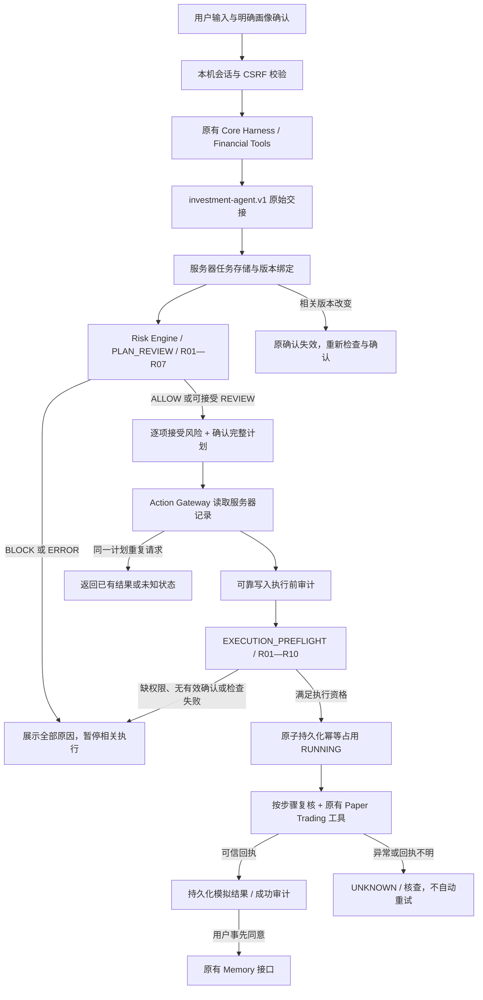

# 风险、确认与执行：实际实现架构

三条状态线独立：

- 风险：`ALLOW / REVIEW / BLOCK / ERROR`；REVIEW 原因接受后仍保留。
- 确认：`UNCONFIRMED → CONFIRMED / REJECTED`，确认后可 `REVOKED / INVALIDATED / EXPIRED`。
- 执行：`NOT_STARTED → RUNNING → SUCCEEDED / UNKNOWN`；调用工具前异常为中止，恢复时先核查持久化状态。

**代码对应：** `engine.cjs` 计算规则；`gateway.cjs` 验证确认和控制执行；`store.cjs` 持久化与审计；`core-adapter.cjs` 适配队友数据和工具；`server.cjs` 提供受保护 HTTP 入口。正式部署需队长统一这些模块的调用边界。
