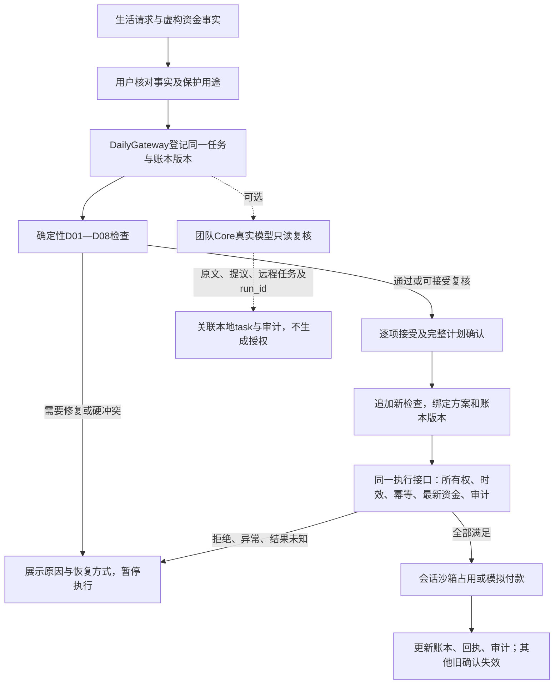

# 日常资金工作台接入说明 v1.0

状态：第四板块已实现会话沙箱，跨模块正式账户与 Risk 回调仍待联调。仅使用虚构资料。

## 1. 入口与能力

沿用现有 `/risk`，默认打开“日常资金”；切换“投资与安全攻防”保留原来的 R01—R10、真实模型攻防及投资健康检查。没有新建展示站点。

日常流程：填写生活请求与资金事实 → 确认事实和用途 → D01—D08 程序检查 → 看原因、缺口、日期和调整建议 → 可选择真实 Agent 只读复核 → 用户确认完整计划 → 网关重检 → 会话沙箱回执和同任务审计。

界面金额使用元，接口使用人民币整数分。未知保留 `null`。所有比例、应急月数仅作用户选择的参考，不能替代学费等明确保护用途。

## 2. 与原接口统一的方式

复用原有 `risk_session`、CSRF、任务所有权、四态结论、`binding`、确认接口、执行接口、幂等记录、审计链与 D1 会话存储。服务端按保存记录的 `kind=DAILY_CASHFLOW` 分流，客户端不能通过伪造类型选执行器。

日常资金使用明确的扩展契约 `daily-risk-workbench.v1`，不把 D01—D08 冒充旧 R01—R10 Schema。旧投资请求及响应保持原契约。正式 Core 接入仍须由架构负责人评审适配。

| 接口 | 用途 | 是否复用原接口 |
| --- | --- | --- |
| `GET /api/safety/session` | 当前浏览器演示会话、CSRF | 是 |
| `POST /api/safety/daily/tasks` | 登记日常事实、用途和拟议动作 | 新增业务入口 |
| `POST /api/safety/daily/revise` | 显式修订、使旧确认失效 | 新增业务入口 |
| `GET /api/safety/daily/policy` | D01—D08 和程序版本 | 新增只读入口 |
| `GET /api/safety/task?task_id=...` | 恢复任务与当前共享账本 | 是 |
| `POST /api/safety/confirm` | 逐项接受可接受风险并确认完整计划 | 是 |
| `POST /api/safety/reject` / `revoke` | 拒绝或撤回未执行计划 | 是 |
| `POST /api/paper-trade/execute` | 日常沙箱或原投资执行器的受控分流 | 是 |
| `GET /api/safety/audit?task_id=...` | 同任务哈希关联审计事件 | 是 |
| `POST /api/safety/daily/model-review` | 团队真实模型只读复核当前任务 | 新增适配入口 |

共享确认字段：`task_id,risk_check_id,binding,accepted_reason_ids,confirmed`。共享执行字段：`task_id,idempotency_key`。不接受客户端提供身份、审批状态、占用、系统权限或执行资格。

## 3. 业务输入与返回

创建请求包含：

```json
{
  "contract_version": "daily-risk-workbench.v1",
  "snapshot": {
    "currency": "CNY",
    "cash_ledger_minor": 1200000,
    "as_of": "2026-10-17T12:00:00+08:00",
    "purposes": [{"purpose_id":"tuition","label":"学费","reserved_now_minor":600000,"remaining_due_minor":600000,"due_at":"2026-10-20T12:00:00+08:00"}],
    "hard_floor": {"state":"DISABLED_CONFIRMED","amount_minor":0},
    "income_events": []
  },
  "action": {"type":"INVESTMENT","amount_minor":100000,"fees_minor":0,"at":"2026-10-17T12:00:00+08:00"},
  "facts_confirmed": true,
  "purposes_confirmed": true,
  "note": "仅用于说明的虚构生活请求"
}
```

- `purposes`：当前预留额与剩余待支付额分开。部分预留不消除未预留部分的到期缺口。
- `hard_floor`：`DISABLED_CONFIRMED / ENABLED_CONFIRMED / UNKNOWN`；保底金额与已有用途重叠时必须有明确关联，不重复扣减。
- `income_events`：`RECEIVED / EXPECTED`，明确是否已计入余额。已计入工资不再加一次，未来工资只进入条件情景。
- `action.type`：`INVESTMENT / PURPOSE_PAYMENT / SUBSCRIPTION_PAYMENT / CONSUMPTION`。同用途支付还需 `matched_purpose_id`；备注自称“交学费”不足以证明用途。
- `budget` 可选：`enabled,category_remaining_minor,require_acceptance`；月度模板另外提供 `period_take_home_minor,needs_minor,goals_minor,wants_minor`，没有启用模板时不强求月收入。
- `emergency` 可选：`enabled,allocation_minor,monthly_essential_minor,target_months,require_acceptance`。本工作台应急金额限定为未分配自由现金中的用户软目标，先使用其他自由现金；保护用途、占用不重复计入。动作后可保留金额重新计算。超出自由现金的归属需修复资料。
- 首个任务创建会话内的虚构账本；后续任务用服务端返回的 `ledger_id,expected_ledger_revision` 共用账本，不能回灌旧余额。显式修订才能修改事实。
- 修订请求增加 `task_id,ledger_id,expected_ledger_revision`。动作、事实或保护改变后重新检查和确认；旧结果留在历史。

返回记录的共同部分：

```text
kind / contract_version / mode
input.binding: task_id,user_id,request_id,run_id,handoff_id,audit_id,
               plan_id,plan_version,plan_hash,ledger_id,ledger_revision,
               ledger_hash,profile_version,constraints_version,policy_version,rules_version
review: decision,risk_check_id,checked_at,checks,reasons,warnings,metrics,gate_reasons
approval / execution / review_history / current_ledger / ledger_stale
```

每条原因包含固定 `rule_id,code,reason_id,message_zh,status,acceptance_allowed,recovery`，并携带计算口径。`metrics.*_minor` 为整数分；计算比例、月数可能为小数。当前账本版本与原检查绑定版本分开展示。

## 4. 规则的实际执行边界

| 规则 | 实际行为 |
| --- | --- |
| D01 数据与计算 | 必要金额、日期未知需补充；类型/关联错误或必要服务失败暂停；未知值不填零 |
| D02 当前资金与硬保护 | 校验学费、房租、生活费、保底、费用；同用途付款只消耗对应预留，防止重复扣减 |
| D03 日期现金流 | 按动作、收入、付款时间复算；未来收入不能成为当前余额；顺序证据不足需复核 |
| D04 跨任务占用与对账 | 同一会话账本的有效占用影响后续任务，版本变化使其他未执行确认失效 |
| D05 预算提醒 | 类别预算、明确启用的月度参考；默认提醒，用户要求逐项接受时才进入可接受复核 |
| D06 应急储备 | 与硬保底分开，按非重叠自由现金计算动作后的软目标；不能把学费再算为应急金 |
| D07 期限与流动性 | 必要变现证据缺失需复核；本版不自动赎回其他资产来弥补缺口 |
| D08 版本与执行门禁 | 用户确认、过期、拒绝、版本、幂等、审计、外部文字隔离独立检查 |

结论统一为 `ALLOW / REVIEW / BLOCK / ERROR`。必要检查失败使用 ERROR；硬冲突 BLOCK；需补资料或明确接受时 REVIEW。保留全部原因，任何非 ALLOW 都不能直接执行。软风险接受后追加新的 ALLOW 检查，原 REVIEW 保留，不把旧记录改写为通过。



## 5. 模拟与真实模型的区分

- 投资模拟创建现金占用，不伪造基金收益；用途支付、消费模拟才扣虚构现金。一次执行仅影响本会话账本，回执 `side_effects=false`。
- 未来时点的安排可以分析，不提前记录成今天已完成。未确认、拒绝、过期、资金变化、未知执行、审计失败均停止。
- 用户可显式调用 `POST /api/safety/daily/model-review`，服务器读取该任务的事实，调用已存在的团队 HTTPS `/api/review`，使用 `model-review.v1 / FUNDING_CONFLICT / SYNTHETIC_REPLAY / PAPER / REVIEW_ONLY`，并绑定 `source_task_id`。
- 返回校验实际模型调用、原文与提议一致性、摘要、上游任务、运行与审计关联；禁用规则回退。成功只表示获得只读模型提议，失败明确显示失败。每任务最多3次，与原入口共用全站每天30次演示限额。
- 模型不能更改保护资金、确认或执行；模型备注中的指令永远是业务数据。Core 正式风险签名回调、真实身份、可信长期 Memory、跨用户真实账户均未在本版本接通。
- 完成一次虚构任务不等于完成团队真实交易主链路。正式接入前保留现有未接网关阻断。

## 6. 运行、验证与交接

```powershell
node modules/safety-risk-eval/server.cjs
# http://127.0.0.1:8780/risk
node --test modules/safety-risk-eval/test/*.test.cjs
node --test modules/safety-risk-eval/hosting/test/*.test.mjs
node modules/safety-risk-eval/hosting/check-daily.cjs http://127.0.0.1:8780
```

部署沿用原 Sites 项目、D1 与访问范围。前端、服务器与 Worker 使用相同的日常引擎和网关。核心代码为 `daily-engine.cjs / daily-gateway.cjs / daily-model.cjs`；界面为 `public/daily.js / daily.css`。

当前 main 尚无此前第四板块运行时，本分支仅恢复已推送 `c909e6478087f82ad58380fdf128aa230602c815` 的第四板块运行时和契约作为依赖，再增加日常工作台；不覆盖第三板块最新文件。

待架构负责人确认：扩展契约进入正式共享目录的版本；Core 风险回调签名与调用路由；正式身份与可信 Memory；跨场景统一账户的原子占用与对账；审计保留与删除策略。本版运行范围明确为会话虚构数据，不替这些依赖作出已完成承诺。
