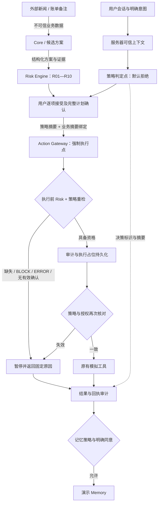

# 策略强制执行的金融 Agent 架构 v0.1

日期：2026-10-10。第四板块实现提案；跨模块接入由团队评审。现有 R01—R10 及 Risk 输入、输出契约保持兼容。

## 产品亮点与实现边界

**大模型提出候选动作，可信服务构造权限上下文，确定性程序判断风险，执行网关决定是否调用工具。** 每次确认绑定完整计划、画像、行情证据及策略摘要；必要检查失败时暂停执行。

| 层次 | 当前状态 | 不应混淆的范围 |
| --- | --- | --- |
| 固定案例与架构图 | 设计验证原型，33 个案例 | 浏览器内预设状态，不是后端授权 |
| 安全攻防工作台 | 确定性 Core、金融规则、权限策略、确认、模拟工具、D1 审计 | 可集成的模拟版本，非真实交易系统 |
| OPA / Agents SDK | 官方设计参考及后续接入约定 | 本轮没有安装 OPA、Rego 运行时或 Python Agents SDK，也没有连接大模型 |

## 运行架构

当前强制执行点覆盖 `paper_trade` 和 `memory.write`。`portfolio.review` 已登记场景契约，但健康检查读取仍经过原服务的会话与字段白名单，尚未改造成通用工具网关。研究工具、商户模块、外部 MCP 等须先登记并接入，不能宣称全团队工具已经受此网关保护。

## 策略、金融风险与确认的组合

- **权限策略**：工具与场景白名单、归属、来源、真实交易禁止、当前授权及记忆同意。本轮输出 ALLOW / BLOCK / ERROR；无可由用户覆盖的策略拒绝。
- **金融风险**：继续使用 ALLOW / REVIEW / BLOCK / ERROR；可接受的 REVIEW 保留原结论与原因，全部接受后才可取得执行资格。
- **用户确认**：不赋予权限，不覆盖硬性阻止。确认与风险、执行三组状态分开存储。
- **执行条件**：策略明确 ALLOW，Risk `executionEligible` 为真，确认有效且摘要一致，幂等检查通过，执行前审计持久化成功。
- **失败关闭**：缺少策略、输入错误、旧任务无策略绑定、内容变更、版本变更均不执行；结果未知保持 UNKNOWN 并核查，不能盲目重试。
- **迁移**：部署前生成的未执行任务必须重新检查、重新确认；已完成任务的重复请求返回原回执，不再次执行。

## 策略接口与审计字段

HTTP 客户端只能提交业务表单及明确确认，不能提交策略配置、身份或 `approval_matches`。以下字段由服务器生成，供未来策略提供器使用。

| 结构 | 字段 | 来源与用途 |
| --- | --- | --- |
| 输入 | subject、owner、source、stage | 会话身份、存储任务归属、可信动作来源、REVIEW / EXECUTE |
| 输入 | tool、operation、scenario | 服务器路由确定；组合必须在白名单中 |
| 输入 | request_hash | binding/context/profile/plan/data_context/upstream 的规范化摘要 |
| 输入 | approval_matches、risk_eligible、memory_consent | 已存储确认与策略/业务摘要比对、金融引擎判断、用户明确选择 |
| 输出 | schema_version、decision_id、checked_at | `policy-decision.v1`、单次决策标识、检查时间 |
| 输出 | policy_version、policy_digest、input_digest、request_hash | 策略和输入的可追溯摘要；摘要不是签名，不替代可信存储 |
| 输出 | stage、tool、scenario、decision、allow、reasons | 强制执行点只接受明确 allow=true；reasons含固定code、中文说明、恢复动作、acceptance_allowed=false |
| 确认绑定 | approval_id、decision_id、policy_version、policy_digest、request_hash | 确认只对当时的策略和完整业务快照有效 |
| 外层审计 | task_id、user_id、binding、correlation_id、event_id、occurred_at | 将策略、R01—R10、确认、执行回执关联到同一任务 |

`POLICY_DECIDED` 记录每次决定；`PLAN_CONFIRMED` 保存策略绑定；`EXECUTION_STARTED` 保存实际放行依据，并在工具调用前持久化。异步持久化结束后再核对版本和确认有效期。失败保留 EXECUTION_ABORTED / UNKNOWN，成功保留 EXECUTION_SUCCEEDED。记忆策略拒绝只阻止后续 Memory，不能把已经完成的模拟操作描述为未发生。

策略配置只由部署端提供，不开放在线编辑。规则算法变化必须升级 `financial-policy-v1` 版本；配置和版本进入摘要。后续集中管理还需签名策略包、发布审批、历史版本恢复以及分布式执行方的同版本约束。

## 固定原因与恢复

| 原因代码 | 条件 | 恢复 |
| --- | --- | --- |
| POLICY_OWNER_MISMATCH | 会话人与资源归属不一致 | 由资源所属用户操作 |
| POLICY_UNTRUSTED_AUTHORITY | 外部文字试图发起有权限动作 | 保留业务数据，由用户独立发起 |
| POLICY_REAL_TRADE_DISABLED | 请求真实交易 | 仅允许模拟 |
| POLICY_TOOL_NOT_ALLOWED | 未登记工具或场景/操作不匹配 | 团队评审并登记能力 |
| POLICY_APPROVAL_STALE | 策略或业务摘要不匹配，缺少绑定 | 重检并重新确认 |
| POLICY_RISK_NOT_ELIGIBLE | 金融规则未具备执行资格 | 按原 Risk 原因修复或接受允许的复核 |
| POLICY_MEMORY_CONSENT_REQUIRED | 未明确同意写入记忆 | 用户自行选择是否保存 |
| POLICY_EVALUATION_FAILED | 策略或输入不可用 | 恢复可信策略与输入 |
| POLICY_DISPATCH_INVALIDATED | 持久化等待期间策略/授权改变 | 不调用工具；核查后创建新计划或重新走审批流程 |

## 与官方设计的对应及下一阶段

OPA 将策略决定与应用执行解耦，提供结构化查询、策略分发与决策日志接口。本轮以本地确定性模块建立判定点与执行点边界，后续可将判定提供器替换为 OPA；网关和 R01—R10 保留。[OPA 集成说明](https://www.openpolicyagent.org/docs/integration)

OPA HTTP 返回 200 并不代表允许：未定义结果可能缺少 `result`。接入时必须校验结构、显式 allow、策略版本、输入摘要；超时、无结果和版本不一致映射为 ERROR。Rego策略与当前实现要共用案例做差异测试，不能未经验证直接替换。

Agents SDK 的 Agent 输入/输出 guardrails 不是每次工具执行的统一拦截点；工具 guardrails 有自己的适用范围。未来只向 Agent 暴露调用受控网关的包装工具，工具输入检查接策略、必要操作设置 `needs_approval`，恢复执行后再次调用网关校验。handoff及不在 FunctionTool管线内的能力单独限制。[工具检查边界](https://openai.github.io/openai-agents-python/guardrails/)、[人工确认流程](https://openai.github.io/openai-agents-python/human_in_the_loop/)

Trace用于运行诊断；业务审计仍由第四板块持久化，不能把模型trace或“模型说已审批”当成执行授权。生产接入前由第一板块统一契约，第二板块提供认证上下文，第三板块隐藏执行凭据与底层工具，第四板块控制判定与网关，第五板块展示真实状态。

## 验证与演示

- 运行 `node --test modules/safety-risk-eval/test/*.test.cjs modules/safety-risk-eval/hosting/test/*.test.mjs`。
- 新增用例：未知工具、跨场景、越权归属、外部授权、真实交易、缺失输入/策略、记忆同意、确认前后策略变化、业务内容未升版变化、持久化期间变更、旧确认迁移、审计关联。
- 页面演示：查看服务器策略版本 → 正常健康检查与确认 → 执行并展开权限策略和审计 → 运行新闻/备注攻击，查看零工具调用及 POLICY_UNTRUSTED_AUTHORITY。
- 策略故障、版本更新属于服务端测试用例，不提供给公开访客修改真实策略的按钮。
- 只报告模拟系统验证；没有真实账户、真实资金或正式合规认证。
