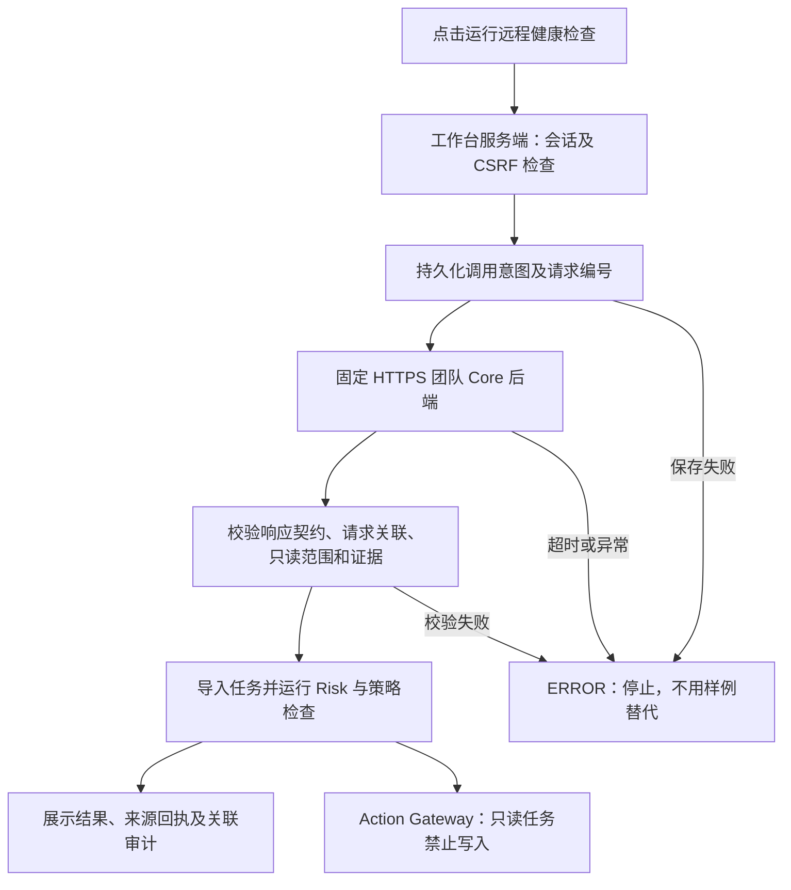

# 远程 Core 联调 v0.1

2026-10-11：已接通用户提供的团队后端，使用固定虚构输入。第四板块仅改动自己的接收、策略、页面和部署适配。团队源码核对基于主分支 `f72b94b`，包括 `cloudflare/worker.js`。

## 实际接通的能力

- 后端：`https://personal-ai-fund-manager-core-agent.realchenchenluo.workers.dev`。
- 健康检查：`GET /health`，验证 `core-agent` 和 `investment-agent.v1`。
- 交接：`POST /api/risk-workbench/handoff`，请求体为 `{request: <health-check.request>}`。
- 上游响应版本：`core-agent-to-risk-workbench.cloudflare@0.1.0`；包含 `agent_response` 与 `risk_workbench`。
- 上游执行确定性的 Core Harness，当前该 Worker 没有调用大模型。公开服务未校验调用方凭据；允许的 CORS 头不能当作已实现鉴权。
- 上游声明 `READ_ONLY_HANDOFF_PREVIEW`、`execution_allowed=false`、`no_execution=true`。接收后仍是只读任务，不能凭普通确认扩大为模拟执行。

10 月 10 日页面读取静态 JSON 是历史观察；10 月 11 日队友已更新页面并接入此后端。本轮不再把后端地址列为缺失项。

## 工作台接口

| 接口 | 输入 | 结果和边界 |
| --- | --- | --- |
| `GET /api/safety/core-status` | 当前演示会话 | 服务健康、固定来源、契约版本、只读范围；不证明模型运行 |
| `POST /api/safety/core-handoff` | 仅 `{"request_key":"<8–80位字母数字或连字符>"}`；有效同源会话和 CSRF | 由服务端生成虚构请求并调用固定后端；返回本地任务、风险结果、来源回执 |
| `GET /api/safety/core-requests` | 当前演示会话 | 该会话的远程请求审计，包含失败路径 |

浏览器不能指定 URL、权限、身份、审批或伪造服务回执。请求编号由服务端生成；验收上游响应编号、契约、只读声明和任务/审计关联后，才导入完整交接包。HTTPS 地址固定，不跟随跳转；响应最大 256 KiB，交接超时 25 秒。失败不降级为固定样例。

同会话同 `request_key` 成功后只返回已保存任务，不再次调用；失败或未完成请求不自动重试。每会话最多 10 次远程请求，并受已有 20 个任务及审计存储限额约束。该限制是公开演示保护，不是正式账户配额。

## 来源与执行资格分开

| 来源 | 判断 | 执行边界 |
| --- | --- | --- |
| 服务端直接获取指定后端响应 | `PINNED_HTTPS_CORE_RESPONSE` | `POLICY_CORE_READ_ONLY` 阻止写入；修改画像、普通确认和直接调用执行接口都不能解除 |
| 浏览器手动导入 JSON | 原有未验证来源状态 | `POLICY_HANDOFF_UNVERIFIED` 阻止执行 |
| 真实模型入口 | 当前没有生产模型配置 | 保持未配置状态，不能把 Core 结果称为大模型输出 |

来源回执是本工作台记录的 HTTPS 调用证据，不是上游签名、正式账号认证或大模型运行证明。权限策略升级为 `financial-policy-v4`，既有确认仍需满足当前策略绑定。

## 审计及失败处理

`REMOTE_CORE_REQUESTED / REMOTE_CORE_RECEIVED / REMOTE_CORE_REPLAY / REMOTE_CORE_FAILED` 关联本地会话和上游请求；成功结果进一步映射原 task/session/handoff/audit 到本地 task。保存 endpoint、请求与响应摘要、时间、契约版本、只读能力、校验方式及失败代码，不保存认证密钥。

执行前必要审计持久化失败时不调用后端；响应或持久化异常时不报告成功。未知结果不能通过重复点击静默重发。

## 验证与后续边界

- 2026-10-12 完整 Node 测试 109 项通过，其中新增远程接入 13 项使用明确的 HTTP 替身，覆盖伪造字段、关联错误、权限扩大、去重、审计失败、归属隔离和拒绝跳转。
- `hosting/check-remote-core.cjs` 使用真实浏览器及真实团队后端验证健康、导入、来源、审计、重复请求、只读拦截、CSRF、桌面/手机无溢出。本地及公网验证通过；[公网报告](online-demo/remote-core-v8-public.json)对应版本 8、北京时间 2026-10-12 01:48。执行状态为 `NOT_STARTED`，没有实际投资操作。
- 版本 6、7 的公网健康检查曾失败。云端日志定位为 Worker 不支持 `redirect:error`；版本 8 改用 `manual` 并拒绝 3xx，不跟随重定向，不降低来源限制。
- 后续真实大模型攻防仍需上游暴露实际模型运行及动作证据，明确可接收的虚构攻击输入和服务鉴权。当前接口只运行健康检查，不具备这项能力，不把人为构造的探针称为模型动作。
- 需要从只读结果生成可执行模拟计划时，由团队统一独立执行契约、授权范围及版本绑定；本轮不自动放宽。
