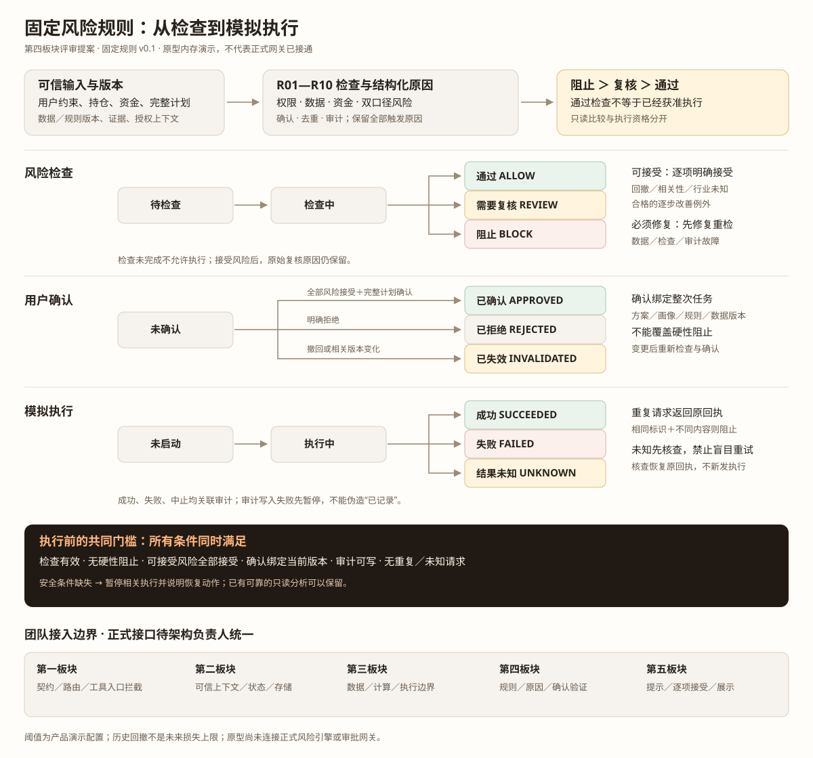
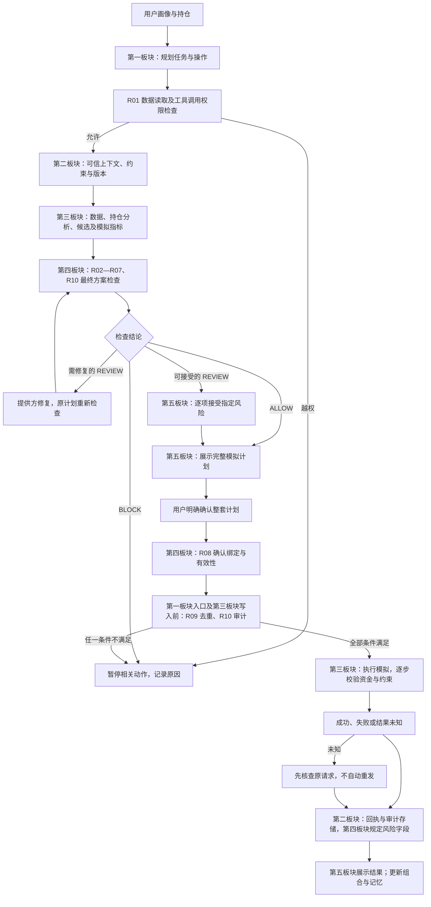
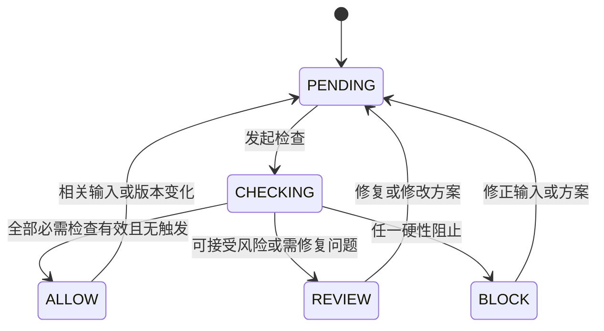
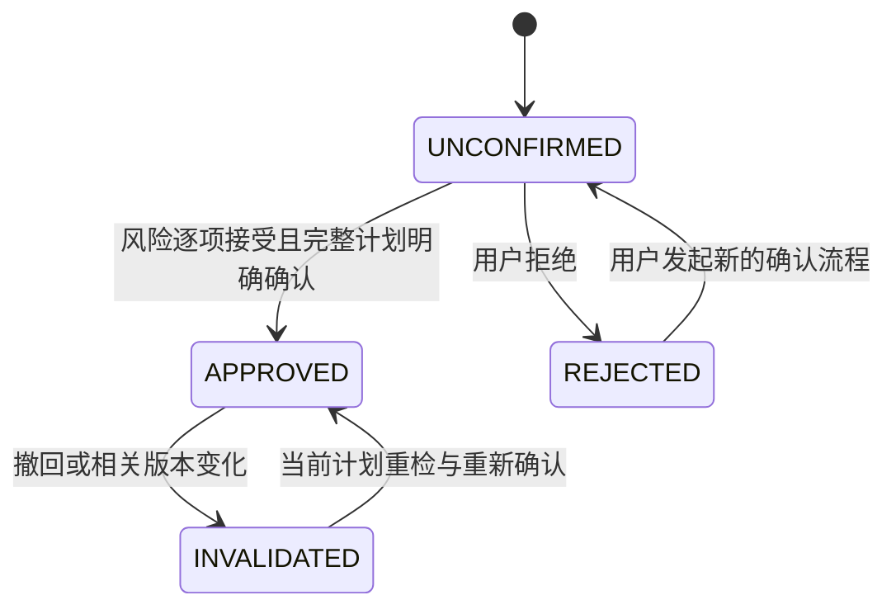
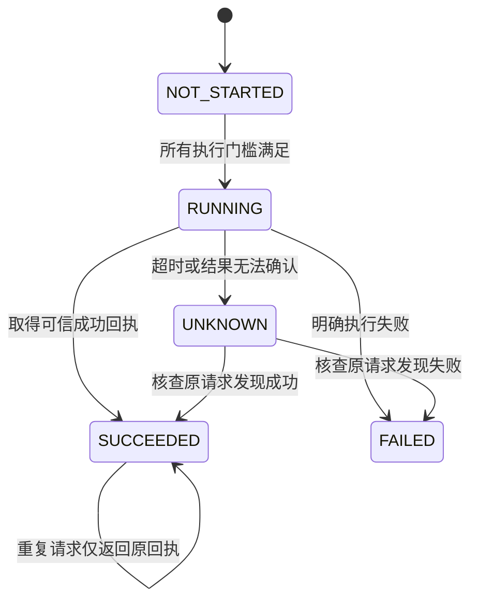

# 风控逻辑架构 v0.1

**状态：第四板块提案已确定，跨模块待团队确认。** 本文是评审架构，不是已接入主流程的实现说明。

## 1. Golden Path接入位置

第一板块负责流程入口的实际阻断，第三板块负责写入边界再次校验。第四板块返回规则结论并验证确认，不能只返回提示而无人拦截执行。

## 2. 三条独立状态线

### 风险检查状态

待检查与检查中没有执行资格。BLOCK＞REVIEW＞ALLOW，并保留全部原因。检查超时按不可确认放行的复核处理；接口不可用时，执行端默认不开启执行。

可接受复核仍保留REVIEW原结论，由用户接受记录解除对应的确认障碍，**不把风险改写成“没有风险”**。必须修复的复核则要修复并重检。

### 用户确认状态

当前原型授权只在匹配版本的整次任务内有效，不设置真实有效期。正式有效期与身份校验需团队统一。整个历史回放计划一次确认，计划变更必须重检和重新确认。

### 执行状态

UNKNOWN不能当FAILED重发。相同标识不同内容阻止；新方案要重新检查和确认，并由执行边界建立新的有效标识。执行之后审计失败不重做交易，而是核查结果并修补记录。

## 3. 执行门槛

所有条件同时满足才允许派发／写入：

1. 可信主体有权进行该模拟操作，环境与资产类型允许。
2. 当前计划有完整有效的风险检查；无BLOCK，无必须修复或核查的REVIEW。
3. 可接受的风险原因全部得到逐项明确接受，包括合格改善方案的剩余超限。
4. 完整计划的确认与当前用户、任务、方案内容、画像、规则、数据和检查版本匹配。
5. 本步资金、可卖持仓、用户硬约束满足；需要的交易规则齐全。
6. 去重状态可确认；没有未知请求或内容冲突。
7. 必要的执行前审计写入成功。

UI禁用只是交互表现，正式执行边界必须自行验证这些条件。外部文字、模型解释与前端布尔值不能替代可信验证。

## 4. 信息交接草案

| 交接 | 最小信息 | 责任 |
| --- | --- | --- |
| 第一／二／三 → 第四 | 任务／会话／主体、授权、用户约束、持仓资金、完整目标及动作、版本、数据模式／来源／时间／窗口、指标及证据、原执行状态 | 第一板块统一契约；第二／三板块提供可信事实 |
| 第四 → 第一／五 | 检查标识与版本、ALLOW／REVIEW／BLOCK、全部Risk Reason、允许／暂停功能、可接受项、修复动作、改善例外及未知项 | 第四板块定义结果，第五板块只展示和收集动作 |
| 第五 → 第一／四 | 确认用户、完整计划引用、逐项接受原因、确认／拒绝／撤回、对应版本与时间 | 第四板块验证，第二板块保留记录 |
| 第一／四 → 第三 | 已验证的执行上下文与授权、当前计划、检查引用、去重标识、执行前审计引用 | 第三板块写入前重新校验，不信任裸前端字段 |
| 各板块 → 第二 | 风险／确认／执行事件及回执引用、版本、时间、错误和缺口 | 第二板块提供持久化与恢复，第四板块规定风险必录字段 |

现有 `investment-agent.v1` 健康检查响应为严格契约；暂不修改。正式阶段须由架构负责人统一独立RiskDecision、Approval及Audit事件如何衔接，不能随意向既有响应增加字段或改写交接中的执行禁止标志。

## 5. 评审关口与验收

- 原型与本文必须使用相同R01—R10、双口径阈值、复核分类及改善例外。
- 评审重点：谁实际拦截工具调用／写入、谁提供可信版本、谁保存去重与审计、哪些风险能接受、失败后如何恢复。
- 原型通过验收只表示规则和交互可评审，不表示正式身份验证、Risk Engine、审批网关或模拟账户已经完成。
- 团队确认后才实现正式程序、接入主流程并完成正式单元与集成测试；数字试算为后续原型增强。
