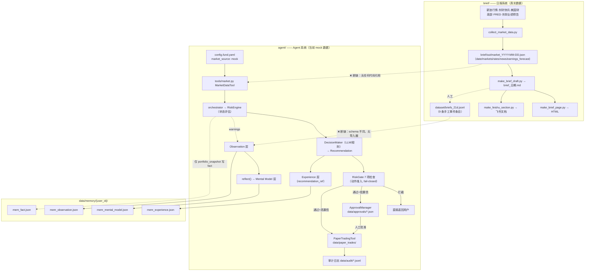

# 审计报告：数据标准化、Memory 治理与集成链路

> 审计日期：2026-10-09 ｜ 审计对象：`D:\会议记录agent`（本地仓库，master @ 17e3478）
> 审计方式：源码逐文件核对 + 落盘数据抽样 + 关键词调用链检索（grep 双向）
> 原则：每条结论标注证据等级。`【源码】`=已由源码证实；`【运行】`=由落盘数据/执行结果证实；`【文档】`=仅文档提出；`【缺口】`=未实现或缺陷；`【待判】`=证据不足。

---

## 0. 审计范围声明（重要）

| 事项 | 结论 |
|---|---|
| 团队仓库 `github.com/Fintechathon-agent/Fintechathon-agent/tree/main/chenchen` | **【待判】不可访问**：匿名返回 404；本机 `gh` 未登录、无 `GH_TOKEN`、无 git-credentials。**未能核实** `chenchen` 目录结构、分支、最近提交与团队约定 |
| 本地仓库关系 | **【源码】**`D:\会议记录agent` 无 git remote（`.git/config` 无 remote 段），`github-push.cmd` 指向另一目标（`Fintechathon-agent/personal-ai-fund-manager`），从未执行 |
| 未提交修改（需保护） | **【源码】** `agent/core/memory.py`（+141 行 Reflect 修复）、`agent/tools/financial_llm.py`（prompt 修正 4 行）、`.gitignore`、`README.md`。**本次修复不覆盖这些改动** |

> 因此本报告的全部结论只对**本地仓库**成立。与团队仓库的兼容性（目录归属、命名约定、Schema 对齐）**无法在本机验证**，需在能访问该仓库的环境复核。

---

## 1. 当前系统数据流图



**核心结论【源码】**：`brief/` 与 `agent/` 是**两套互不引用的系统**——双向 grep（`brief/` 中搜 `agent.`/`MemoryLayer`、`agent/` 中搜 `brief/`/`market_2026`）**结果均为空**。日报数据从未进入 Memory；Agent 的风控/决策也未使用日报的任何数据。

---

## 2. Data Layer 实际实现情况

### 2.1 日报采集（brief/collect_market_data.py，397 行）

| 项 | 现状 | 证据 |
|---|---|---|
| 数据源 | 新浪 `hq.sinajs.cn`（需 Referer）、东财快讯 `newsapi.eastmoney.com`、美国财政部官网每日收益率曲线、FRED `fredgraph.csv`、东财数据中心 `RPT_PUBLIC_OP_NEWPREDICT` | 【源码】L67-79、L341；各 fetch/parse 函数 |
| 重试/容错 | 单次 `requests.get(timeout=10)`，**无重试、无降级源**（失败即抛异常或该项为空） | 【源码】L69 |
| 输出 | `out/market_YYYY-MM-DD.json`，`generated_at` 为**无时区的本地时间字符串** `"%Y-%m-%d %H:%M:%S"` | 【源码】L341 |
| Schema 校验 | **无**任何校验器；`requirements.txt` 也不存在 | 【缺口】全仓库无 `jsonschema` 使用、无 requirements |

### 2.2 Agent 行情工具（agent/tools/market.py，240 行）

| 项 | 现状 | 证据 |
|---|---|---|
| 接口 | `MarketDataTool.get_price / get_batch / get_historical` | 【源码】L37-L49 |
| 主数据源 | akshare `stock_zh_a_spot_em()`（**全市场快照逐次拉取，无缓存**） | 【源码】L90 |
| 降级 | akshare 缺失或异常 → **静默降级 mock**，仅 `logger.warning` | 【源码】L43-45、L107 |
| mock 设计 | 参考价表 + md5 哈希生成稳定价格；`source="mock"` 字段正确标注 | 【源码】L113-160 |
| 实际运行配置 | `config.fund.yaml` + `config.fund.relay.yaml` 均为 **`market_source: "mock"`** | 【源码】两个 yaml 的 `financial.market_source` |
| 历史数据 | `get_historical` 支持 akshare+mock；Quant/Backtest 依赖它 | 【源码】L162-212 |

**风险【缺口】**：mock 与真实数据在接口层**无法区分真假**（只靠 `source` 字段自觉），而 `source` 从未被下游（RiskGate/RiskEngine/DecisionMaker）读取或校验。若真实源临时失效，系统会带着 mock 价格静默完成风控与决策。

---

## 3. 当前 JSON 数据结构

### 3.1 日报采集输出 `brief/out/market_2026-10-08.json`【运行】

```
date: "2026-10-08"
generated_at: "2026-10-08 18:00:26"        ← 无时区
markets: { a_share[3], hk[1], us[3], commodity[4], fx[1] }
   每条: { name, last, change, change_pct, date, time }
rates:   { official: {date,us10y,us30y,prev_date,prev_us10y,prev_us30y,source},
           us10y: {series,date,value}, us30y: {series,date,value} }
news:    [100 条] { time, title, category[], url }   ← 全部来自东财快讯（转载源）
earnings_forecast: { report_date, total, positive, negative, loss_narrowed,
                     uncertain, breakdown{10 类}, source }
```

**缺失字段【缺口】**：`schema_version`、`observed_at`（采集时刻，带时区）、`verification_status`（如"双源交叉通过"）、逐条的 `source`（现在只有 `rates.official.source` 和 `earnings_forecast.source` 两处有来源标注）、`record_type`。

### 3.2 手工事件数据集 `brief/dataset/briefs_21d.jsonl`【运行】

9 条，schema 意外地完整，是仓库里**唯一接近目标契约**的结构：

```
id / date / stage{source, raw_ref}
event{type, headline, facts{}, as_of(带 +08:00 时区), source{name, url}}
explanation{mechanism, why_matters, confidence: high|medium|low}
risk{direction, affected_assets[], horizon, severity: 1-3}
agent_mapping{layer, module, usage}
decision{question, options[], team_answer, outcome_check{at:"T+1", result:""}}
```

**优点**：`as_of` 带时区；`raw_ref` 指回原始 JSON（可追溯）；`confidence` 是**枚举而非伪概率**；`outcome_check` 预留了 T+1 回填。
**缺口**：与运行时 `MemoryEntry`（见 §4）**无字段映射、无导入代码**；`decision.team_answer`、`outcome_check.result` 大多为空（T+1 回填未实现成流程）。

### 3.3 运行时记忆 `data/memory/demo_user/mem_fact.json`【运行】

```
id(8位uuid) / layer / content / created_at / updated_at / confidence(0.5起) /
source / tags[] / superseded_by / supporting_ids[] / contradictory_ids[] /
verify_after / last_verified / evidence_days[] / reinforce_count
```

实际 3 条内容均为「用户demo_user组合中X行业占比Y%」，来源=`portfolio_snapshot`。**没有任何一条市场事实**。

---

## 4. 三类 Memory 的实际实现情况

运行时是 **Hindsight 四层**（比任务要求的三类多两层、且边界不同）：

| 任务要求三类 | 代码现状 | 证据 | 判定 |
|---|---|---|---|
| **World Facts** | `MemoryLayer.FACT` 存在 | 【源码】contracts/types.py L260；memory.py L186-195 | 部分实现：结构齐全（verify_after/last_verified），但**写入源只有组合行业占比一种**（memory.py L780-786），无市场事实、无日报数据 |
| **User Memory** | **不存在** | 【源码】`grep -rn "user_memory\|UserMemory"` 全仓库 0 命中；`MemoryLayer` 无 USER 值 | **缺口**：`UserProfile`（contracts/types.py L33-50）是纯运行时对象，从不写入任何记忆层；每次会话的偏好来自 config 默认值，无"用户确认"落盘通道，也没有任何"授权"概念 |
| **Experience Memory** | `MemoryLayer.EXPERIENCE` 存在 | 【源码】contracts/types.py L295-299；memory.py L196-206 | 已实现：`outcome/recommendation_ref/actual_return_pct` 字段齐全；写入点 = `save_recommendation`（memory.py L681）+ `update_feedback`（L692-728，本次未提交修改已修正"批准≠盈利"语义） |
| （额外）Observation | `MemoryLayer.OBSERVATION` | 【源码】loop.py L287-309 写风险警告 | 已实现；驱动 reflect |
| （额外）Mental Model | `MemoryLayer.MENTAL_MODEL` | 【源码】memory.py reflect() L306-411 | 已实现（本次未提交修改修复了"证据按天数而非条数累积"的关键 bug） |

**memory_type 与核验状态**：当前**没有** `memory_type`、`verification_status` 字段；`confidence` 是启发式值（0.5 起，支持 +0.10 / 矛盾 -0.20 / 每日衰减 0.005，见 memory.py L40-52），**不是统计概率**，且无任何字段说明其口径——下游 Consumer（如 LLM Context 的"高置信度规则" memory.py L835-839）直接当作可信度展示。

---

## 5. 数据进入 Memory 的实际调用链（逐条核实）

| 声称 | 实际 | 证据 |
|---|---|---|
| 日报写入 Memory | **不成立**。`brief/` 无 `from agent...`、无 `MemoryLayer` 引用；`agent/` 无 `brief/` 引用 | 【源码】双向 grep 空 |
| `agent/core/memory.py` 入库（日报 10-08 ⑤ 表述） | 代码存在但**调用方只有**：`loop.py`（observation）、`memory.py`（experience/fact）、`memory_tools.py`（MCP 包装） | 【源码】`grep -rn "\.retain("` 共 5 处 |
| fact 层的历史保留 | `retain()` 去重按 content 归一化后完全一致才合并；**内容不同则新增**，同日重复只刷新不涨分（L146-158） | 【源码】符合"不同日期各自保留"的要求 |
| fact 修订关系 | `superseded_by` 字段存在但**无自动 supersede 逻辑**（只有 recall 会跳过被替代项） | 【缺口】memory.py L274 |
| 失败记录 | 写入异常在 loop.py 被 `except Exception` 吞掉后仅 warning | 【源码】loop.py L309-310 |

**结论**：链路"日报 JSON → Evidence → 记忆"**整体缺失**，这是本次任务最核心的缺口。

---

## 6. Research / Quant / Risk / Human Approval 集成情况

| 模块 | 实现 | 评级 |
|---|---|---|
| **Research** | `tools/financial_llm.py` 提供 4 个 prompt（组合分析/风险评估/决策/舆情），`FinancialLLM` 封装 JSON 调用 | 【缺口】日报声称的"归因模块：多候选归因+置信度"**不存在**（grep "归因" 仅命中 prompt 文本，无实现）；无"研究假设（hypothesis）"数据结构 |
| **Quant** | `tools/backtest.py` 存在（基于 mock 历史）；`tools/whatif.py` 情景推演为确定性本地计算，`MetricDelta` 支持前后对比 | 【运行】README §情景推演有真实输出样例；whatif 不依赖网络 |
| **Risk** | 双层：`risk/engine.py`（状态评估：评分/VaR估算/回撤估算/集中度/违规）→ `risk/gate.py`（动作准入 7 项检查，**fail-closed**：单项异常记 `检查执行异常`+block） | 【源码】gate.py L114-126；设计质量高 |
| **Human Approval** | `risk/approval.py` + loop.py 分流：`blocked` → 不执行不排队；`requires_approval`（confidence<0.70）→ 排队等待；否则自动纸交易 | 【源码】loop.py L141-172 |
| **授权边界** | 纸交易（paper_trade）为主；`web/app.py` 对"持有类建议与闸门拦截的建议不占审批队列"，红色档（买/卖）须人工确认 | 【源码】web/app.py L378-395 |

### 已知缺陷（审批）

1. **`list_pending(user_id)` 过滤是空操作**【源码】approval.py L65-69：`(not user_id or True)` —— 永远返回全部。且 `ApprovalRequest` 无 `user_id` 字段，无法真正过滤。
2. **审批落盘丢失上下文**【源码】approval.py L82-96：`_request_to_dict` 只存 recommendation 的 6 个字段；`_dict_to_request` 将 `portfolio_snapshot/risk_report` 置 `None`（L113-114）。web 层用 `_rehydrate_approvals` 做**显式降级**（evidence 留空而非编造，app.py L200-203）——处理方式正确，但"审批当时的组合与风险快照"永久丢失。
3. **经验反馈与审批的关联靠时间戳后缀**【源码】memory.py `_find_experience` L731-752（未提交修改中已改进为可回退按标的匹配）。

---

## 7. 测试、依赖与 Schema 工具

| 项 | 现状 | 证据 |
|---|---|---|
| 测试文件 | **0 个**（无 `test_*.py`、无 `conftest.py`、无 pytest 配置） | 【源码】find 结果 |
| 依赖清单 | **无** `requirements.txt` / `pyproject.toml` | 【源码】ls 结果 |
| 已安装环境 | akshare 1.18.88 / jsonschema 4.26.0 / httpx 0.28.1 / requests 2.32.5 / pandas 2.3.3 / numpy 2.2.6；tushare、pydantic **未装** | 【运行】importlib 探测 |
| Schema 校验器 | 无。jsonschema 已安装但 0 处使用 | 【源码】grep |
| 数据验证器 | 无 | 【缺口】 |
| 结构化日志 | `agent/risk/audit.py` JSONL 审计（仅 2 种 action：portfolio_review、paper_trade_execution） | 【运行】`data/audit/audit_2026-09-30.jsonl` 仅 2 行 |
| 异常处理 | 较完备：retry.py、gate fail-closed、memory 读写均 try/except | 【源码】 |

---

## 8. 问题清单与严重程度

### P0（错误数据进入决策 / 未授权执行 / 破坏数据）—— 本轮未发现确定性 P0

| # | 问题 | 位置 | 说明 |
|---|---|---|---|
| P0-候选 | Agent 在 mock 模式下的全部输出可能被误当作真实数据链 | config.fund*.yaml `market_source: mock` | 缓解：`MarketData.source="mock"` 已标注、web 有 `DEMO_TAG`。**但无代码级强制**（下游不校验 source）。列为 P1 处理 |

### P1（数据正确性 / 来源追溯 / Memory 分类 / 关键集成）

| # | 问题 | 位置 | 证据 |
|---|---|---|---|
| P1-1 | **日报数据完全未进入 Memory**：fact 层唯一来源是组合行业占比；日报声称的"入 Memory（World Facts）"在代码中不存在 | brief/ ↔ agent/ 全断链 | §5 |
| P1-2 | **User Memory 类别不存在**：用户偏好/约束/授权无落盘通道；配置默认值与"用户确认"无法区分 | contracts/types.py、memory.py | §4 |
| P1-3 | **数据契约缺关键字段**：日报 JSON 无 `observed_at`（带时区）/`schema_version`/逐条 `source`/`verification_status`；`generated_at` 无时区 | collect_market_data.py L341 | §3.1 |
| P1-4 | **审批队列无法按用户过滤**：`list_pending` 的过滤恒真；ApprovalRequest 无 user_id | approval.py L65-69 | §6 |
| P1-5 | **`confidence` 语义未声明**：启发式值无口径说明、无校准；下游（LLM prompt/界面）可能当作概率 | memory.py L40-52 | §4 |
| P1-6 | **无任何测试与依赖清单**：团队仓库集成时无法复现环境 | 全仓库 | §7 |

### P2（可维护性 / 可观测性 / 扩展）

| # | 问题 | 位置 |
|---|---|---|
| P2-1 | 审批落盘丢失 portfolio/risk 快照（web 已显式降级，非静默） | approval.py L82-114 |
| P2-2 | 采集无重试、无降级源；`requests.get` 单次超时即失败 | collect_market_data.py L69 |
| P2-3 | AuditLogger 覆盖面窄：仅 2 类 action；文档声称"记录所有操作"与实现不符 | audit.py L18-39 |
| P2-4 | 矛盾检测用正负关键词表（"涨/跌"即触发），误判率高，且会直接改 confidence | memory.py L492-512 |
| P2-5 | `recall` 的 RRF 输入用序号而非真实命中分；0 命中条目也进排名 | memory.py L281-290 |
| P2-6 | `_record_observations` 只取前 3 条 warning，超出部分静默丢弃 | loop.py L296 |
| P2-7 | `RiskReport.var_95/max_drawdown` 为简化估算，无方法说明字段 | engine.py L52-57 |

### P3（优化建议）

- P3-1 为 `market.py` 增加快照缓存，避免每次 `get_price` 拉全市场。
- P3-2 `briefs_21d.jsonl` 的 `outcome_check` T+1 回填可脚本化。
- P3-3 统一 `generated_at`/`as_of` 的时间格式与命名。

---

## 9. 与日报描述不符的声明（"设计 ≠ 实现"实例）

| 日报/任务书中表述 | 实际核实 |
|---|---|
| "agent/tools/financial_llm.py 归因模块：价格与消息矛盾时输出多候选归因+置信度" | **不存在**该模块；仅有 4 个 prompt 模板 + 简单封装 |
| "伊朗地缘：入库时需带可信度标记，验证后再升级为 World Fact" | 无 `verification_status` 字段、无"待确认事实"暂存区；事实一旦 retain 即按普通 fact 参与检索 |
| "记录团队答案，T+1 回填，用于 DecisionMaker 置信度校准" | `briefs_21d.jsonl` 有 `team_answer/outcome_check` 字段但多为空；**无回填代码**、无校准代码 |
| "agent/core/memory.py 的 Hindsight 四层"（任务书称 World Facts/User/Experience 三类） | 四层为 fact/experience/observation/mental_model；**无 user 层** |

---

## 10. 最小改动修复方案（本轮执行）

> 原则：复用现有结构（`HindsightMemoryStore.retain`、`MemoryLayer`、`daily brief JSON`），不引入数据库/框架，不重写任何现有模块，不动未提交修改涉及的文件行。

| 序 | 修复 | 文件 | 改动量 | 对应问题 |
|---|---|---|---|---|
| 1 | 新增「日报 → Memory」导入器：读 `brief/out/market_*.json`，把行情/利率/业绩预告写入 fact 层（content 内嵌日期与数据时间、source 标注文件与来源、tags 分类），支持 `--dry-run` 预览与幂等重跑 | 新增 `brief/ingest_to_memory.py` | ~150 行 | P1-1 |
| 2 | 新增 `MemoryLayer.USER` + `MemoryUser`（`preference_type/confirmed_by_user/scope`）+ `save_user_profile()/load_user_profile()`：写入用户章程，系统默认值 `confirmed_by_user=False`，用户显式确认才置 True；内容变化时旧条 `superseded_by` | contracts/types.py、memory.py（追加，不改现有行） | ~70 行 | P1-2、P2-4 边界 |
| 3 | 采集输出补 `schema_version`、`observed_at`（ISO 8601 带时区）；`generated_at` 保留原格式避免破坏现有消费者（`make_brief_draft.py` L214 会显示它） | collect_market_data.py | ~5 行 | P1-3 |
| 4 | 修 `list_pending` 过滤；`ApprovalRequest` 增加 `user_id`（默认空串，向后兼容）；落盘/加载带上 `user_id` 并在审批记录中补 `portfolio_summary/risk_summary` 摘要 | approval.py、contracts/types.py、loop.py | ~45 行 | P1-4、P2-1 |
| 5 | 新增 `requirements.txt`（按实际 import 锁定，标注实测版本） | 新增 | ~12 行 | P1-6 |
| 6 | 新增最小自检脚本：`brief/verify_contract.py`（校验日报 JSON 必备字段 + 时区 + 来源标注；退出码非 0 表示失败） | 新增 | ~80 行 | P1-3、P1-6 |

**明确不做（记录为后续项）**：完整 JSON Schema Draft 2020-12 体系、Research 研究假设结构、T+1 回填自动化、audit 全覆盖、RRF/矛盾检测算法改造——均超出"最小必要修复"，避免与团队仓库现有安排冲突。

**confidence 口径（写入修复代码注释，不伪造成概率）**：沿用 `retain()` 的启发式值（0.5 基线的支持/矛盾演化），语义 = "记忆系统对该条目反复被观察到的一致性评分"，**非统计概率**；日报导入不人为设定更高初值。

---

*报告结束。修复实施见同目录《修复说明》或 git diff。*
