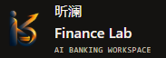
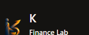
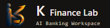
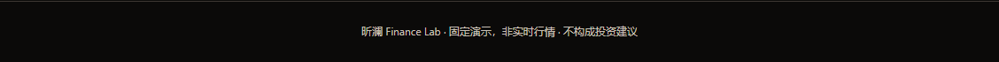
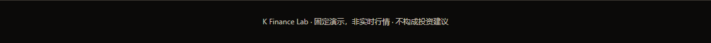

# Finance Lab 视觉与交互微调验收

日期：2026-10-15。仅本地修改与提交，未推送、未合并 main。

## 预览

- A：http://127.0.0.1:4187/workspace.html?brand=a#workspace
- B（推荐，默认）：http://127.0.0.1:4187/workspace.html?brand=b#workspace
- 完整入口：http://127.0.0.1:4187/landing.html

A 为 Logo + K，下行 Finance Lab；B 为 Logo + K Finance Lab 紧凑排列。两版均保留 AI Banking Workspace，小屏可自然换行。页脚改为 K Finance Lab，保留固定演示、非实时行情、不构成投资建议。Logo 文件没有修改。网站现有页面中的旧中文品牌文字及无障碍标签同步清理。

## 焦点效果

原来四个现有模块互相隐藏，滚轮无法跨模块浏览。本轮只调整显示与导航：原模块连续显示，未复制组件、未增加业务模块。使用 IntersectionObserver 配合节流滚动回调，按可见区域中心选定一个模块；导航 aria-current=location 同步。点击导航仍定位现有模块，地址片段随焦点更新，不新增滚动历史记录。

当前模块使用低透明度橙色边框、柔和阴影与 -3px 抬升；hover 增至 -4px。同一时刻只高亮一个模块。移动端保留可见导航，并按实际导航高度留出定位空间；减少动效开启时取消位移和过渡。

## 前后对比

|原顶部|版本 A|版本 B|
|---|---|---|
||||

原页脚：

新页脚：

## 四个模块与移动端

- [工作台高亮](visual-polish/active-workspace.png)
- [银行业务高亮](visual-polish/active-banking.png)
- [我的任务高亮](visual-polish/active-tasks.png)
- [安全与记录高亮](visual-polish/active-safety.png)
- [移动端](visual-polish/mobile.png)

## 验证

- 新视觉交互检查 5 组通过：A/B、四模块导航、实际鼠标滚轮、减少动效、390/375 移动端。滚动和品牌切换期间没有 POST 请求。
- Axe 零违规；无 JavaScript 错误。
- 原 P0 浏览器回归 15/15；没有删改断言，只为检查脚本增加可选证据输出目录，避免覆盖上轮记录。
- 状态模型与网站 HTTP 检查合计 12/12。
- JavaScript 语法检查通过。
- 原 Node 全套上轮遗留的首页资产断言失败未修改，本轮没有宣称它已修复，也没有重跑无业务变更的后端全套。
- 曾发现移动端 A/B 按钮覆盖导航，已修复并重跑通过。测试脚本 Axe 上下文初始化问题已修复。

## 文件

HTML：chenchen/versions/workspace.html、home.html、investment.html、investment-legacy.html、merchant.html、risk-workbench.html。除 workspace.html 的品牌/显示调整外，其余仅清理旧品牌名称与标签。

CSS：chenchen/versions/workspace.css。

JS：chenchen/versions/workspace.js，仅导航、滚动焦点与品牌排版。

检查：chenchen/scripts/visual-polish-check.cjs；workspace-browser-check.cjs 支持单独证据目录。

证据：review/visual-polish/。未修改 server.js、API、Core、Risk、审批、PAPER 或其他后端业务。
